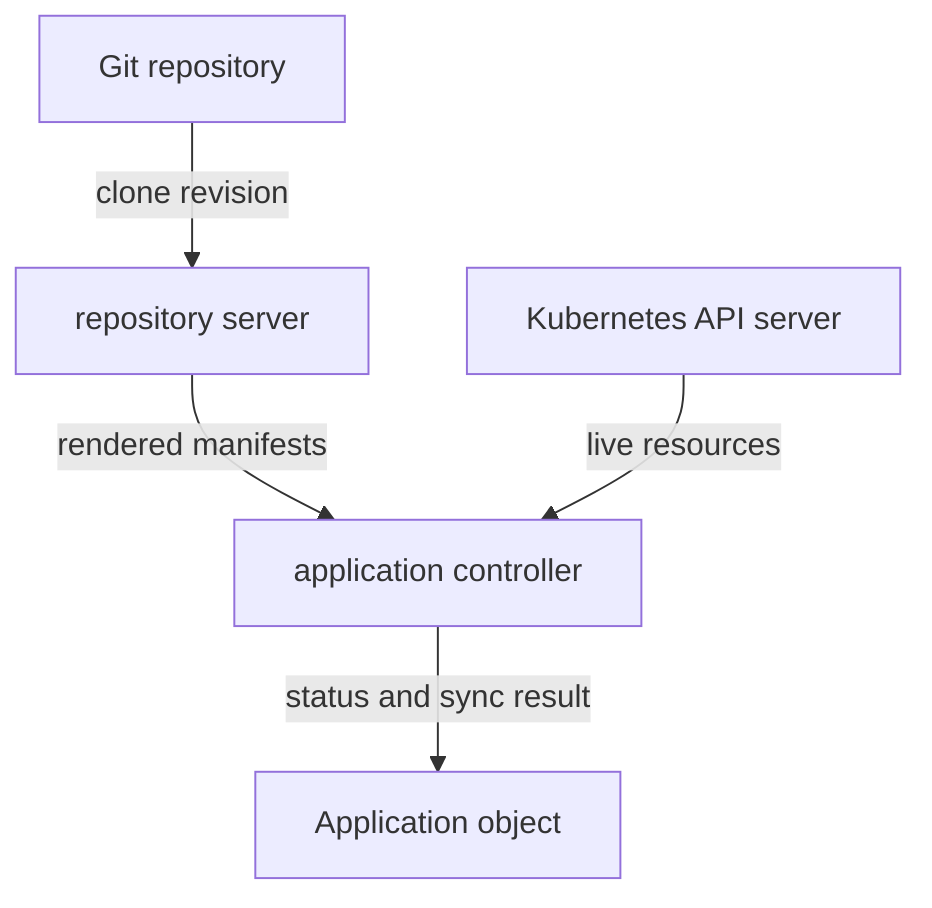
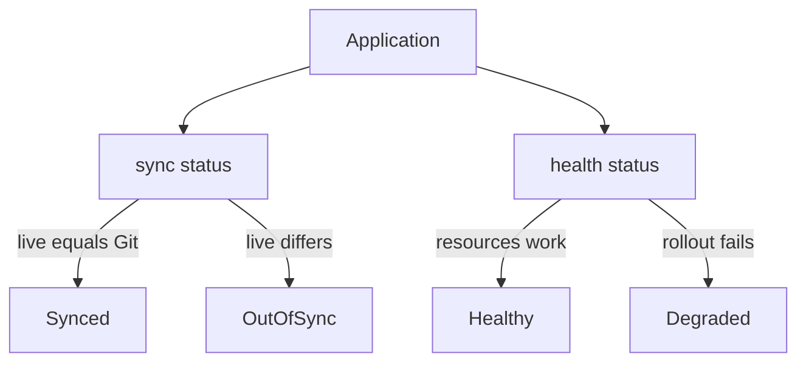

# Argo CD Desired State And Reconciliation

A team that deploys with `kubectl apply` from a laptop has no record of what is running, no way to see who changed it, and no way to know whether the cluster still matches what they intended last week. GitOps removes that gap by storing the intended state in Git and letting a controller keep the cluster equal to it. Argo CD is the controller this course studies. This part explains the loop it runs and the words you need to read its status.

## Desired state, live state and reconciliation

**Desired state** is the set of Kubernetes resources that should exist. **Live state** is the set of resources that exist in the cluster right now, as the Kubernetes API server reports them. **Reconciliation** is the repeated work of comparing the two and acting on the difference. A Kubernetes controller is a program that watches resources and does this kind of work continuously. Argo CD adds one more controller to the cluster for the resources that Git describes.

Four components take part, and each has one job:



The diagram shows that the repository server produces the desired state, the application controller compares it with the live state, and the result is written to the Application object.

The **repository server** (`argocd-repo-server`) clones the Git repository, checks out the requested revision and turns the files into plain Kubernetes manifests. The **application controller** (`argocd-application-controller`) reads those manifests, reads the live resources from the Kubernetes API server, compares them and updates the status. It also applies manifests when a sync runs. The next part describes all components in detail. For now, remember the split: one component renders, one compares and applies.

## The Application

Argo CD stores its configuration as Kubernetes objects. An **Application** is a custom resource, an object kind that Argo CD adds to the Kubernetes API through a custom resource definition (CRD). One Application describes one deployment: where the manifests are and where they should run.

Here is the smallest useful Application:

```yaml
apiVersion: argoproj.io/v1alpha1
kind: Application
metadata:
  name: mission
  namespace: argocd
spec:
  project: default
  source:
    repoURL: http://git-source.argocd.svc:8080/repo.git
    targetRevision: main
    path: plain
  destination:
    server: https://kubernetes.default.svc
    namespace: starfleet
```

The Application object lives in the `argocd` namespace. It does not contain the Deployment. It contains a pointer to it, and the fields have fixed meanings:

- `spec.source.repoURL` is the Git repository that holds the manifests.
- `spec.source.targetRevision` is the branch, tag or commit to read. A branch name follows new commits. A tag or a full commit hash stays fixed.
- `spec.source.path` is the directory inside the repository to render.
- `spec.destination.server` is the API address of the cluster that receives the resources. The address `https://kubernetes.default.svc` means the cluster Argo CD itself runs in.
- `spec.destination.namespace` is the namespace for resources that do not name their own.
- `spec.project` is the project the Application belongs to. The project `default` allows every source and destination.

## A commit is not yet desired state

A Git commit holds files. The files may be plain manifests, a Helm chart, a Kustomize overlay or a directory of mixed content. Argo CD detects the kind from the directory and asks the repository server to render it. The result of that rendering is the desired state. Two different directories can render to the same resources, and one directory can render to different resources when its parameters change.

Rendering has two consequences. First, a problem in the source appears as an error on the Application, not as a failed workload. If the path does not exist or a template is invalid, no desired state exists and the comparison cannot run. Second, rendering should give the same result every time. A template that inserts a random value or reads a changing input produces a different desired state on each comparison, and the Application reports permanent differences.

## Live state and the comparison

The application controller watches the live resources of every Application. It matches each rendered resource with a live resource by group, kind, namespace and name, and it compares the fields the manifest declares. Fields that the Kubernetes API server fills in by default, such as `status`, are not part of the comparison unless the manifest sets them.

Argo CD must also know which live resources belong to which Application. It records this with a tracking annotation, `argocd.argoproj.io/tracking-id`, on every resource it creates. The value starts with the Application name, so a resource tracked as `mission:apps/Deployment:starfleet/git-probe` belongs to the Application `mission`. Without the marker, Argo CD could not tell which extra resources it should prune.

## Two statuses that answer different questions

The Application reports two independent statuses. **Sync status** answers whether the live state matches the desired state. Its values are `Synced`, `OutOfSync` and `Unknown`. `Unknown` means the comparison could not run, for example because the source could not be rendered.

**Health status** answers whether the resources work. Argo CD evaluates built-in rules per resource kind. A Deployment is `Healthy` when its rollout is complete and the replicas are available, `Progressing` while it rolls out, and `Degraded` when the rollout fails. The Application health is the worst health among its resources.



The diagram shows two separate questions that the same Application answers with two separate fields.

The two fields combine freely. `Synced` and `Degraded` means Argo CD applied exactly what Git describes, and the workload still does not work, for example because an image tag does not exist. `OutOfSync` and `Healthy` means a running workload differs from Git, for example after someone scaled it by hand. Read both fields before you decide what is wrong.

## Drift and how Argo CD resolves it

**Drift** is a difference between live state and desired state. It has two sources: someone changes the cluster by hand, or someone commits a change to Git. Either way the sync status becomes `OutOfSync`.

A **sync** is the operation that applies the desired state to the cluster. With **manual sync**, a person or a tool starts the operation. With **automated sync**, set under `spec.syncPolicy.automated`, the application controller starts it whenever the Application is `OutOfSync`. Two options extend automated sync:

- `prune: true` lets a sync delete live resources that are no longer in the desired state. Without it, Argo CD leaves them and reports the Application as needing pruning.
- `selfHeal: true` lets the controller sync again when the cluster changes by hand, not only when Git changes. Without it, a manual change stays until the next change in Git.

Pruning and self-healing are deliberately separate switches. Deleting resources is a stronger action than re-applying declared ones, so Argo CD asks you to enable it explicitly.

## Who does what when a step fails

Each step of the loop has its own failure signature. A wrong repository URL, path or revision stops the repository server, so the Application shows sync status `Unknown` and an error condition. A denied write or an invalid manifest stops the application controller during the sync, so the sync operation fails while the sync status stays `OutOfSync`. A working apply of a broken workload leaves the sync status `Synced` and the health status `Progressing` or `Degraded`. Diagnose in order: source, rendering, comparison, application, health.

You now know the loop from a commit to a status, the Application fields that steer it and the two statuses that report it. The next question is how to see it work in a real cluster: what a new Application looks like before and after its first sync, and what happens when someone edits the cluster by hand.

## Common pitfalls

> [!WARNING]
> `Synced` does not mean the application works. It means live equals Git. Always read the health status too. Do not assume a branch name is fixed: `main` moves with every commit, so use a tag or a commit hash when you need a stable revision. Do not turn on `prune` before you know which resources the Application owns.
