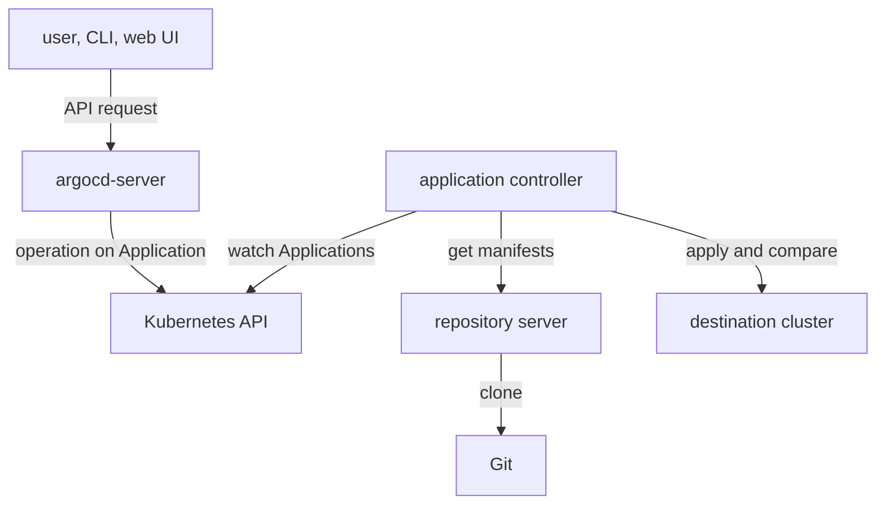

# Argo CD Components And Their Roles

When a sync fails, the message on the Application often names a component that the user never configured: the repository server, the application controller, Redis. A person who knows only the Application object cannot tell where to look. This part describes each component, what it talks to and why it exists, so that a symptom leads to the right workload.

## One installation, seven components

Argo CD installs into one namespace, usually `argocd`. The standard installation manifest creates six Deployments and one StatefulSet. Each one runs one process:

| Component | Workload | Role |
| --- | --- | --- |
| API server | Deployment `argocd-server` | Serves the web interface, the command-line client and the API |
| Repository server | Deployment `argocd-repo-server` | Clones Git and renders manifests |
| Application controller | StatefulSet `argocd-application-controller` | Compares live state with desired state and applies it |
| Redis | Deployment `argocd-redis` | Caches cluster state and rendered manifests |
| ApplicationSet controller | Deployment `argocd-applicationset-controller` | Generates Applications from templates |
| Dex server | Deployment `argocd-dex-server` | Connects single sign-on identity providers |
| Notifications controller | Deployment `argocd-notifications-controller` | Sends messages about Application events |

Five of these ship in the same container image, `quay.io/argoproj/argocd`, and start different programs: `argocd-server`, `argocd-repo-server`, `argocd-application-controller`, `argocd-applicationset-controller` and `argocd-notifications` are all binaries in that image. The Deployment spec names which one runs, so you can read a pod's role from its `args`. Redis and Dex use their own images.

## The three components that deliver applications

Three components carry the delivery loop. The others support them.

The **repository server** is an internal service that listens on port 8081. It has no user interface and applies nothing to the cluster it deploys to. Given a repository URL, a revision, a path and the template settings of the Application, it keeps a local clone, checks out the revision and renders the directory into plain manifests. Rendering runs Helm, Kustomize or a plain directory read. It returns the manifests to the caller and does not apply them. Credentials for private repositories are stored in Kubernetes Secrets, and the callers pass them to the repository server with each request.

The **application controller** is a Kubernetes controller that runs as a StatefulSet. It watches the live resources in every destination cluster, asks the repository server for the desired manifests, compares the two and writes the result into the `status` of each Application. It starts syncs under an automated sync policy, applies manifests during a sync and runs hooks. It is the only component that changes resources in the destination cluster. Because it does the comparing and the applying, it is the busiest component, and large installations run several replicas that split the Applications between them.

The **API server** (`argocd-server`) exposes a gRPC and REST API for the web interface, the `argocd` command-line client and automation. It authenticates users, applies Argo CD's own role-based access control (RBAC), manages repository and cluster credentials, receives Git webhook events, and starts operations such as sync and rollback on behalf of users. It does not render manifests and does not compare state. When you press Sync in the web interface, the API server records the request on the Application and the application controller does the work.

The diagram shows that the API server and the application controller never talk to each other directly: they share state through Application objects stored in the Kubernetes API.

## Supporting components

**Redis** is an in-memory data store. Argo CD uses it only as a cache. The application controller keeps a cache of the live resource tree there, and the repository server keeps the rendered manifests for each combination of repository, revision, path and settings. A cache hit saves a Git fetch and a render. Redis holds nothing that cannot be rebuilt, which is why the installation starts it without persistence. If Redis is unavailable, Argo CD gets slower and fails to show some data, but Git stays the source of truth.

The **ApplicationSet controller** adds a second custom resource, `ApplicationSet`. An ApplicationSet has generators that produce a list of parameter sets, for example one per cluster or one per directory in Git, and a template that turns each parameter set into an Application. The controller creates, updates and deletes those Applications. It never syncs them: the application controller does that for each generated Application as for any other.

The **Dex server** is an identity broker. Dex lets Argo CD log users in through an external identity provider such as GitHub, LDAP or an OpenID Connect service. If the installation uses only local accounts, or its own OpenID Connect configuration, Dex has no work. The **notifications controller** watches Applications and sends messages to external services such as chat or email when a trigger condition becomes true, for example a failed sync. Neither of these components takes part in deploying, so an Application can sync without them.

## What each component reads and writes

A useful way to remember the architecture is to list what each component is allowed to change:

- The application controller changes resources in destination clusters and the `status` and `operation` fields of Applications.
- The API server changes Application objects, projects and the secrets that hold credentials. It changes no workload resources.
- The repository server changes nothing in Kubernetes. It writes only to its own disk and to Redis.
- The ApplicationSet controller changes Application objects that it owns.

This matters for diagnosis. A failure to render points to the repository server and its access to Git. A failure to apply points to the application controller and its permissions in the destination. A failure to log in points to the API server and Dex. A failure to show an update in time points to the cache and the refresh path.

## How the components find each other

Components reach each other through Kubernetes Services in the same namespace. The Service `argocd-repo-server` exposes port 8081 and is the address the application controller and the API server call to render manifests. The Service `argocd-redis` exposes port 6379. The Service `argocd-server` exposes ports 80 and 443 for users and automation. Each component also has a metrics port for monitoring: 8082 on the application controller, 8083 on the API server, 8084 on the repository server and 9001 on the notifications controller.

This wiring explains a common symptom. If the repository server pod is not ready, the Service has no endpoints, every render request fails, and every Application that needs a new render turns to an error at the same time. Applications whose manifests are already cached keep showing their old result. A single broken Application points to its own source. Many broken Applications at once point to a shared component.

## Replicas and scaling

The components scale differently. The API server and the repository server are stateless. You can run several replicas of each behind their Services, and a larger installation does exactly that when many users or many large repositories load them. The application controller is a StatefulSet because each replica owns a fixed share of the clusters and Applications, and the share is calculated from the replica number. The controller reads the total replica count from the environment variable `ARGOCD_CONTROLLER_REPLICAS`, so a change to the replica count must also change that variable. For this reason, change it through the installation manifest and not with a quick scale command.

In a small installation each component runs as one replica. That is the case in the playground, with one extra detail: the Dex server and the notifications controller have zero replicas, so their Deployments exist but run no pods.

## What the architecture does not do

Argo CD does not build images, run tests or decide what to deploy. It does not poll the container registry for new image tags. It reads Git, renders manifests and keeps one cluster equal to the result. A pipeline that builds an image must still commit the new tag to Git before Argo CD notices a change. This narrow scope keeps each component small and makes a failure easy to place.

## Where the configuration lives

The components read their settings from a few Kubernetes ConfigMaps and Secrets in the same namespace. `argocd-cm` holds general settings such as the resource tracking method and the reconciliation timeout. `argocd-cmd-params-cm` holds command parameters for the components, such as log levels and server addresses. `argocd-rbac-cm` holds Argo CD's own access rules. `argocd-secret` holds the administrator password hash and the key used to sign login tokens. Credentials for repositories are Secrets that carry a label that marks them as repository credentials.

You now know the seven components, what each one changes and which ones carry the delivery loop. The open question is how they cooperate in time: what happens between a commit and a status change, and what happens between a click on Sync and a running pod.

## Common pitfalls

> [!WARNING]
> Do not blame the application controller for every failure. A path or revision that does not exist is a repository server problem, and the application controller only reports it. Do not assume a component is broken because a Deployment shows zero replicas: Dex and the notifications controller are optional. Do not treat Redis as a database. It is a cache, and it is safe to lose.
