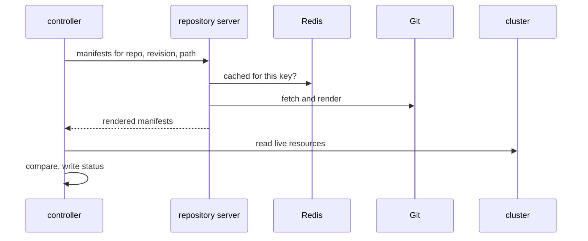

# Follow A Refresh And A Sync Through The Components

A status on an Application is the end of a chain: a trigger, a render, a comparison and, sometimes, an apply. If you know the chain, you can read the cause of a bad status from the right workload. This part follows a refresh and a sync through the components, then uses `kubectl` to read the role of each workload and to diagnose a real error in the playground.

## The path of a refresh

A **refresh** is a new comparison of the desired state with the live state. The application controller starts one in four situations:

- A live resource that belongs to the Application changes. The controller watches those resources, so a manual edit starts a refresh almost at once.
- The reconciliation interval ends. The setting `timeout.reconciliation` in `argocd-cm` is two minutes by default, plus a random delay set by `timeout.reconciliation.jitter`, one minute by default. The delay spreads the work, so all Applications do not refresh in the same second.
- A Git webhook arrives at the API server. The API server tells the controller which Applications use that repository and revision.
- A user asks for it, with the refresh button, a command-line option, or the annotation `argocd.argoproj.io/refresh` set to `normal` or `hard` on the Application. The controller removes the annotation when the refresh ends.

Once started, a refresh runs the same steps:



The diagram shows that the controller asks the repository server for manifests, the repository server answers from the cache when it can and from Git when it cannot, and the controller does the comparison itself.

A **normal refresh** reuses the cached manifests when the cache key is still valid. The key includes the resolved commit, the path and the rendering settings. A **hard refresh** discards the cached manifests and the cached cluster state first. Use a hard refresh when you suspect a stale cache, for example after you fixed a path and the status still shows the old error.

## The path of a sync

A **sync** applies the desired state to the cluster. It is stored as an **operation** on the Application. The path has four steps:

1. Something sets `operation.sync` on the Application. The API server does it when a user clicks Sync or runs a sync command. The application controller does it when an automated sync policy applies. You can do it yourself with `kubectl patch`.
2. The application controller sees the operation and reads the current manifests from the repository server, as in a refresh.
3. The controller applies the resources to the destination cluster in an order: hooks that run before the sync, then resources in the order of their sync waves, then hooks that run after. It applies each resource with the same logic as `kubectl apply`.
4. The controller writes the result to `status.operationState` and removes the operation. The fields `phase`, `message` and `syncResult` hold the outcome.

Only the application controller changes resources in the destination. If a sync fails with a permission error, the cause is the controller's access to the destination, not the API server.

## Read the role of each workload

Start the playground work. Point `kubectl` at the playground cluster:

<!-- astrona:playground:renew -->

```sh
export KUBECONFIG="$(astrona kubeconfig ats-061-playground-010-02)"
kubectl config current-context
```

The context must be `kind-astro-ats-061-playground-010-02`. List the workloads of Argo CD:

```sh
kubectl -n argocd get deployments,statefulsets -o wide
```

You should see six Deployments and one StatefulSet. The column `READY` shows `1/1` for most of them and `0/0` for `argocd-dex-server` and `argocd-notifications-controller`, which this environment scales to zero. The `IMAGES` column shows that several workloads use the same Argo CD image, so the image does not tell the role. The program does:

```sh
kubectl -n argocd get deployment argocd-repo-server -o jsonpath='{.spec.template.spec.containers[0].args}{"\n"}'
kubectl -n argocd get statefulset argocd-application-controller -o jsonpath='{.spec.template.spec.containers[0].args}{"\n"}'
```

The first command prints the program `/usr/local/bin/argocd-repo-server` and the second prints `/usr/local/bin/argocd-application-controller`. The name of the program is the role. The kind tells you the scaling behaviour: the application controller is a StatefulSet.

## Cause and read a comparison error

Create an Application whose path has a typo. It has automated sync, so it will deliver the workload as soon as the source is correct.

Save this as `application-crew-roster.yaml`:

```yaml
apiVersion: argoproj.io/v1alpha1
kind: Application
metadata:
  name: crew-roster
  namespace: argocd
spec:
  project: default
  source:
    repoURL: http://git-source.argocd.svc:8080/repo.git
    targetRevision: main
    path: workloads/alfa
  destination:
    server: https://kubernetes.default.svc
    namespace: starfleet
  syncPolicy:
    automated:
      prune: true
      selfHeal: true
```

Apply it:

```sh
kubectl apply -f application-crew-roster.yaml
```

Then check the result:

```sh
kubectl -n argocd get application crew-roster
kubectl -n argocd get application crew-roster -o jsonpath='{range .status.conditions[*]}{.type}{": "}{.message}{"\n"}{end}'
```

The sync status is `Unknown`. The comparison never ran, because the repository server could not produce manifests. The condition has the type `ComparisonError` and its message names the path that does not exist. The error is stored on the Application, but the component that raised it is the repository server. Confirm that in its log:

```sh
kubectl -n argocd logs deployment/argocd-repo-server --tail=30
kubectl -n argocd logs statefulset/argocd-application-controller --tail=30
```

Read the two logs side by side. The repository server log has the failed render, with the Application's path in it. The application controller log records that it received the error and set the condition. Look for the Application name `crew-roster` in the lines. If the lines you want have scrolled away, raise `--tail` or add `--since=5m`.

## Repair the source and force a fresh comparison

The fix is the correct path, `workloads/alpha`. Patch the Application and ask for a hard refresh, which discards the cached error:

```sh
kubectl -n argocd patch application crew-roster --type merge -p '{"spec":{"source":{"path":"workloads/alpha"}}}'
kubectl -n argocd annotate application crew-roster argocd.argoproj.io/refresh=hard --overwrite
kubectl -n argocd wait --for=jsonpath='{.status.sync.status}'=Synced application/crew-roster --timeout=180s
kubectl -n argocd wait --for=jsonpath='{.status.health.status}'=Healthy application/crew-roster --timeout=180s
```

A change of the Application spec starts a refresh by itself, so the annotation is a safeguard here. When the wait ends, the `alpha` Deployment runs in `starfleet`, the condition list is empty and `status.sync.revision` holds a commit hash.

You have followed one error from the Application status to the repository server log and back to a repair. The method works for any symptom: decide from the status which step of the chain failed, open the log of the component that owns that step, find the Application name in it, change the source or the permission, and refresh. The next question is how to read the rest of the Application status, not only the error, and how the command-line client shows it.

## Common pitfalls

> [!WARNING]
> Do not restart the application controller to clear a `ComparisonError`. The error comes from the source and comes back after the restart. Do not read only one log: the repository server shows the render and the controller shows the comparison. Do not use a hard refresh as the first fix, because it hides the real cause. `kubectl logs deployment/<name>` shows only one pod, so if you scale a component to several replicas, check the others as well.
