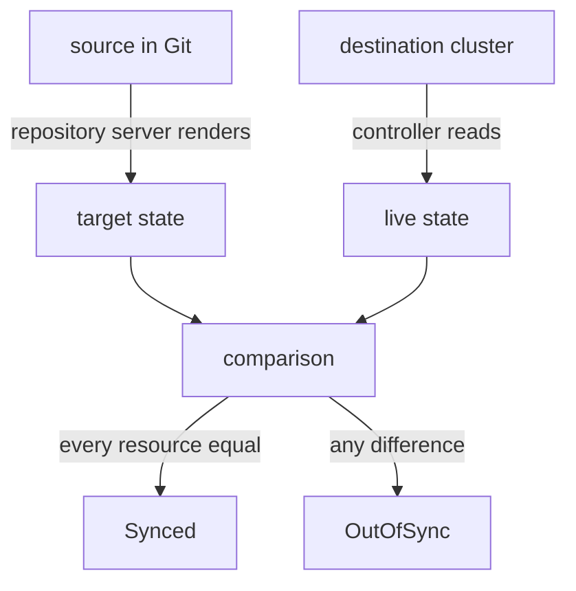

# Applications, Projects And Status Fields

People new to Argo CD read the word "status" as one thing and then misread it. An Application has a sync status, a health status, a status for every resource it owns and an operation state for its last sync. Each answers a different question, and each has fixed values. This part defines the objects and the status vocabulary so that every field on an Application can be read with its exact meaning.

## Application and AppProject

An **Application** is a custom resource, an object kind that Argo CD adds to the Kubernetes API, that connects one source to one destination. It lives in the `argocd` namespace by default. Its `spec` has the source (`repoURL`, `targetRevision`, `path`), the destination (`server` or `name`, and `namespace`), the project and the sync policy. Its `status` is written by the application controller. You never write the status.

An **AppProject** is a second custom resource that limits what Applications may do. Every Application belongs to exactly one project, named in `spec.project`. A project can restrict:

- The source repositories the Applications may read, in `spec.sourceRepos`.
- The destination clusters and namespaces they may deploy to, in `spec.destinations`.
- The kinds of cluster-scoped and namespace-scoped resources they may create.
- The roles of Argo CD's own role-based access control that apply to the project.

Argo CD creates a project named `default` that allows every repository, every destination and every resource kind. It is a convenient starting point and no boundary at all. A team that needs a boundary creates a project with narrow lists and puts its Applications in it. An Application that breaks a project rule gets an error condition, and its sync does not run.

## Target state and live state

The **target state** is the desired state: the manifests that the repository server renders from the source. The **live state** is the resources that exist in the destination cluster, as the Kubernetes API server returns them. Argo CD holds both in memory for each Application and compares them resource by resource. The comparison is what produces the sync status.

The diagram shows that the target state comes from Git through the repository server, the live state comes from the cluster, and the comparison yields the sync status.

## Sync status

The **sync status** says whether the live state equals the target state. For an Application it has three values:

- `Synced`: every compared resource equals its target.
- `OutOfSync`: at least one resource differs, is missing, or exists live without a target and would be pruned.
- `Unknown`: Argo CD could not compare, usually because the repository server could not render the source. An error condition on the Application gives the reason.

Each resource in `status.resources` also has its own sync status. The Application is `OutOfSync` when any resource is. This lets you find the culprit: read the resource list and look for the one marked `OutOfSync`.

## Health status

The **health status** says whether a resource works. Argo CD has built-in rules per resource kind. The values are:

- `Healthy`: the resource works as intended.
- `Progressing`: the resource is not healthy yet and may still become so. A Deployment that rolls out is `Progressing`.
- `Degraded`: the resource failed. A Deployment whose rollout does not finish within its progress deadline, 600 seconds by default, is `Degraded`.
- `Suspended`: the resource is paused and waits for something outside, for example a suspended CronJob.
- `Missing`: the resource does not exist in the cluster.
- `Unknown`: Argo CD has no rule or could not assess the resource.

The health of an Application is the worst health among its resources, in this order from best to worst: `Healthy`, `Suspended`, `Progressing`, `Missing`, `Degraded`, `Unknown`. One `Degraded` Deployment makes the whole Application `Degraded`, even if ten other resources are `Healthy`.

## The four combinations

The two statuses are independent, so a table of the main combinations tells you where to look:

| Sync | Health | What it usually means |
| --- | --- | --- |
| `Synced` | `Healthy` | Live equals Git and the workload works. |
| `Synced` | `Degraded` or `Progressing` | Argo CD applied what Git says and the workload does not work, for example a bad image tag. Fix the manifest in Git. |
| `OutOfSync` | `Healthy` | The workload works but differs from Git: manual change, or a new commit that is not synced yet. |
| `Unknown` | any | The comparison did not run. Read the conditions. |

Another case belongs here: a new Application whose resources do not exist yet is `OutOfSync` and `Missing`.

## Refresh and hard refresh

A **refresh** repeats the comparison: the controller asks the repository server for manifests and reads the live state again. Argo CD refreshes by itself when a watched resource changes, when the reconciliation interval ends and when a webhook arrives. You can force one. A **hard refresh** also discards the cached manifests and the cached cluster state, so the repository server clones and renders again. A refresh updates the status. It never syncs, so it never changes the cluster.

## Resource tracking

Argo CD has to know which live resources belong to which Application, or it could not tell a resource to prune from an unrelated one. It records ownership on each resource it creates. The setting `application.resourceTrackingMethod` in `argocd-cm` chooses how:

- `annotation`, the default, sets the annotation `argocd.argoproj.io/tracking-id`. Its value has the form `application:group/kind:namespace/name`, for example `bridge-cam:apps/Deployment:starfleet/beta`.
- `label` sets the label `app.kubernetes.io/instance` to the Application name. This is the older method.
- `annotation+label` sets both.

A label value is limited to 63 characters and an annotation value has no such limit, which is one reason annotation tracking is the default. The tracking value also names the group, kind and namespace, so two resources with the same name in different places never share a marker.

## Operation state

A sync is an **operation**, and its outcome is kept in `status.operationState`. The field `phase` has the values `Running`, `Succeeded`, `Failed`, `Error` and `Terminating`. The field `message` says why, `startedAt` and `finishedAt` give the times and `syncResult` lists the resources applied and the revision synced. The operation state describes the last sync, not the present: an Application can be `Synced` with a `Succeeded` operation and later `OutOfSync` because someone edited the cluster, while the operation state still says `Succeeded`. The list `status.history` records the revisions deployed earlier.

You now have the vocabulary: the project, the target and live states, the two statuses and their values, the tracking marker and the operation state. What remains is practice at reading them quickly, which is what the command-line client is for.

## Common pitfalls

> [!WARNING]
> Do not read `Synced` as "working": check health too. Do not read `phase: Succeeded` as "in sync now": it describes the last sync only. Do not think the `default` project protects anything. Do not use a refresh to repair a problem: a refresh reads and compares, and only a sync or an automated sync policy changes the cluster.
