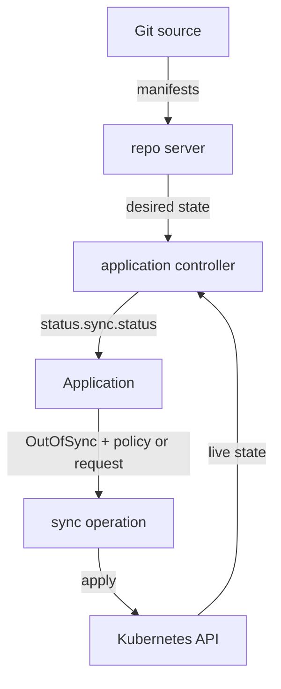

# Comparison, Manual Sync And Automated Sync

A team commits a change to Git and expects the cluster to follow. In Argo CD two separate things must happen for that. The first is a comparison, which finds the difference. The second is a sync, which removes it. Mixing them up leads to a common wrong belief: that an Application that shows `OutOfSync` is already being repaired. It is not, unless a sync policy says so. This part shows who does each step and how the two ways of starting a sync differ.

## Comparison and sync are different operations

The application controller is the Argo CD component that watches Applications and the cluster. It asks the repository server (repo server) for the manifests that a source produces, reads the live objects from the Kubernetes API, and compares the two. The result is stored in the Application's `status.sync.status`. The value is `Synced` when the live objects match the desired manifests, and `OutOfSync` when they do not. The same comparison also yields `Unknown` when it cannot be completed, for example when the Git server cannot be reached.

A sync is an operation. The controller runs it only when something asks for it. During a sync the controller takes the desired manifests, applies them to the destination cluster in a defined order, and records the outcome in `status.operationState`. The comparison happens on a timer and on events. The sync happens on request.



The diagram shows that the controller compares desired and live state first and starts the apply step only after a policy or a request asks for it.

## What a sync operation records

Every sync writes an `operationState` into the Application status. The field `phase` holds the state of the operation, such as `Running`, `Succeeded`, `Failed` or `Error`. The field `message` holds a short result text. The field `syncResult` lists the revision that was applied and one entry per resource with the result of applying it. The operation also adds an entry to `status.history`, which later parts of the course use for rollback.

To read the phase of the last operation of an Application named `mission`, run:

<!-- astrona:playground:renew -->

```sh
kubectl -n argocd get application mission -o jsonpath='{.status.operationState.phase}'
```

The command prints the phase as plain text. If the Application never synced, the field does not exist and the command prints nothing. An empty result is therefore a valid answer: no operation has run.

## Manual sync

A manual sync is a sync that a person or a tool requests. You can request it in the web interface with the Sync button, with the `argocd app sync` command, or by writing an `operation` field into the Application resource. The controller sees the request, runs the operation and clears the request when the operation ends.

The `argocd` command-line tool can run without an Argo CD API server login. In core mode it talks to the Kubernetes API directly, using your kubeconfig. Set the current namespace to `argocd` and log in to core mode once:

```sh
kubectl config set-context --current --namespace=argocd
argocd login --core
```

Then request a sync of the Application `mission`:

```sh
argocd app sync mission --core
```

The command asks the controller to sync, waits for the operation to end and prints the per-resource result. A manual sync always applies the current desired state, even when the Application is already `Synced`. For an Application that has no `syncPolicy`, a manual sync is the only way to change the cluster.

## Automated sync

Automated sync means the application controller requests the sync itself. You turn it on with the `automated` field in the sync policy of the Application:

```yaml
spec:
  syncPolicy:
    automated: {}
```

An empty `automated` object is enough. With it present, the controller starts a sync whenever it finds the Application `OutOfSync`. A new commit in Git, a changed value in the Application and a manual change of a live object are all causes of `OutOfSync`, but only the first two start a sync under this minimal policy. The third needs `selfHeal`, which the next part explains.

Automated sync has rules that surprise people:

- It starts only when the Application is `OutOfSync`. A `Synced` Application gets no operation.
- It starts at most once for the same commit and the same source parameters. If that sync fails, the controller does not try again on the next comparison. The Application stays `OutOfSync` until a new commit, a changed parameter, or a retry policy changes the situation.
- It does not start for an Application in an error state, such as a comparison error caused by a bad path.
- It cannot be combined with rollback. Argo CD refuses a rollback for an Application with automated sync turned on.

## Choosing between the two

Manual sync keeps a human decision between Git and the cluster. It suits a change that needs a review window or a risky production step. Automated sync removes that step and makes Git the only input: the cluster follows every merged commit. Both are valid. The important point for the exam is that the policy belongs to the Application, so two Applications that read the same Git path can use different policies.

Automated sync also changes the failure picture. With manual sync, a failed apply is visible at the moment you run it. With automated sync, a failed apply happens in the background, and the only evidence is the `operationState` and the `OutOfSync` status. Monitoring has to read those fields.

## Summary of the part

You now know that the controller compares on its own, that a sync is a separate operation recorded in `operationState`, and that a manual sync and an automated sync produce the same kind of operation. What differs is who asks for it. The open question is what automation does with objects that exist in the cluster but no longer exist in Git, and with objects someone changed by hand. Prune and self-heal answer those two questions.

## Common pitfalls

> [!WARNING]
> `OutOfSync` does not mean Argo CD is fixing the difference. Without an `automated` policy, nothing changes until someone syncs. An automated sync that failed for one commit is not retried for that same commit, so a failed Application can stay `OutOfSync` for a long time with no new operation.
