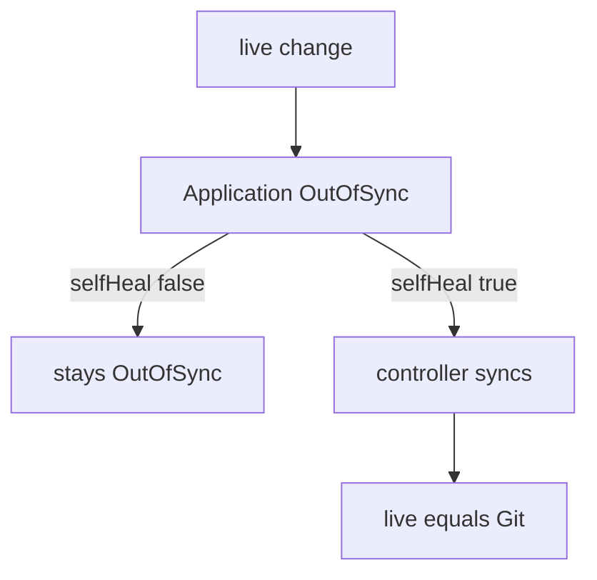

# Pruning And Self-Healing

Automated sync makes the cluster follow Git, but "follow" has two halves. Adding and changing objects is the easy half. Removing an object that Git no longer declares, and undoing a change someone made directly in the cluster, are the risky halves. Argo CD keeps both off by default and gives each its own switch. This part explains what each switch does, what protects an object from them, and how the application controller decides that something is drift.

## Pruning removes objects that Git dropped

Argo CD records which objects belong to an Application. By default it does this with a tracking label or annotation on every object it applies, so it can tell its own objects from other objects in the same namespace. Pruning means deleting an object that carries this tracking information when its manifest is no longer part of the desired state.

Without prune, a manifest deleted from Git leaves its object running in the cluster. The Application then shows the object as `OutOfSync` with a pending delete, and nothing deletes it. That is a safe default, because a mistaken commit cannot remove a database. To allow automated deletion, set `prune`:

```yaml
spec:
  syncPolicy:
    automated:
      prune: true
```

A manual sync prunes only when you ask for it, with the Prune option in the web interface or the `--prune` flag of `argocd app sync`. The flag `argocd app set --auto-prune` changes the Application policy instead.

## The empty application guard

If a commit removes every manifest from the path, automated prune would delete every object of the Application. Argo CD blocks this by default. The field `allowEmpty` lifts the block:

```yaml
spec:
  syncPolicy:
    automated:
      prune: true
      allowEmpty: true
```

Leave `allowEmpty` at its default unless an empty Application is a real, intended state. The guard exists because an empty directory is much more often a mistake, such as a wrong path or a failed render.

## Protecting a single object from pruning

Some objects must survive even when Git drops them. A per-object sync option handles this. Add the annotation `argocd.argoproj.io/sync-options: Prune=false` to the manifest in Git. Argo CD then never prunes that object, in manual or automated syncs. The related option `Prune=confirm` pauses the sync until a person confirms the deletion.

## Self-heal reverts changes made in the cluster

The second switch is `selfHeal`. By default the controller reacts to Git changes only. If someone runs `kubectl scale deployment git-probe --replicas=1` against a managed Deployment, the live state now differs from Git, the Application becomes `OutOfSync`, and nothing else happens. With `selfHeal: true` the controller starts a sync for that drift:

```yaml
spec:
  syncPolicy:
    automated:
      selfHeal: true
```

The sync applies the manifest from Git again, so the replica count returns to the declared value. Self-heal repeats the attempt after a short delay when drift continues. The default delay is five seconds and an administrator can change it with the `--self-heal-timeout-seconds` option of the application controller.

Self-heal is the only reason an already-attempted revision is synced again. The rule "one automated sync per commit" has this exception: when self-heal is on, drift on the same commit triggers another sync.

## What counts as drift

The controller compares the fields that the manifest declares. A field that the manifest does not mention is not compared, so a controller that adds an annotation or a status does not cause drift. A Horizontal Pod Autoscaler that changes `spec.replicas` does cause drift when the manifest declares `replicas`. The usual fix is to remove `replicas` from the manifest, or to tell Argo CD to ignore that field. Self-heal fights any declared field that another actor changes, so a field that something else owns should not be declared.



The diagram shows that the value of `selfHeal` alone decides whether a live change is reported or reverted.

## Emergency changes and self-heal

Self-heal makes a manual hotfix disappear within seconds. During an incident that can be the wrong behavior. There are two accepted ways to handle it. You can commit the hotfix to Git, which is the preferred path because the change then survives. Or you can switch automation off for the duration of the incident by removing the `automated` block from the Application, fix the cluster by hand, and put the policy back after the commit lands.

## A worked example

Take an Application with automated sync, `prune: true` and `selfHeal: false`. The path holds a Deployment `git-probe` and a Service `git-probe`. A commit removes the Service manifest. At the next comparison the Application is `OutOfSync` because the live Service has no manifest. The controller starts an automated sync, applies the Deployment unchanged, and deletes the Service because it is tracked and pruning is on.

Now someone scales the Deployment to one replica by hand. The Application shows `OutOfSync` again, but `selfHeal` is false, so the controller starts no sync. The Deployment keeps one replica until the next commit or a manual sync. Changing `selfHeal` to `true` changes the Application itself, which makes it `OutOfSync` for a different reason. The controller then syncs, and the replica count returns to two.

The example shows the two switches acting on different events. A Git change feeds prune. A live change feeds self-heal.

## What the part showed

Prune and self-heal are independent. Prune answers "may automation delete what Git dropped", self-heal answers "may automation undo what someone changed in the cluster". Each has a safe default of off, a switch in `syncPolicy.automated`, and a way to protect individual objects or to pause the policy. What is still open is the order in which a sync applies many objects, and what runs before and after them.

## Common pitfalls

> [!WARNING]
> Turning on `prune` together with a wrong `path` or a wrong `targetRevision` can remove a whole workload at the next automated sync. Change the source and the policy in two separate steps, and check the diff before enabling prune.
