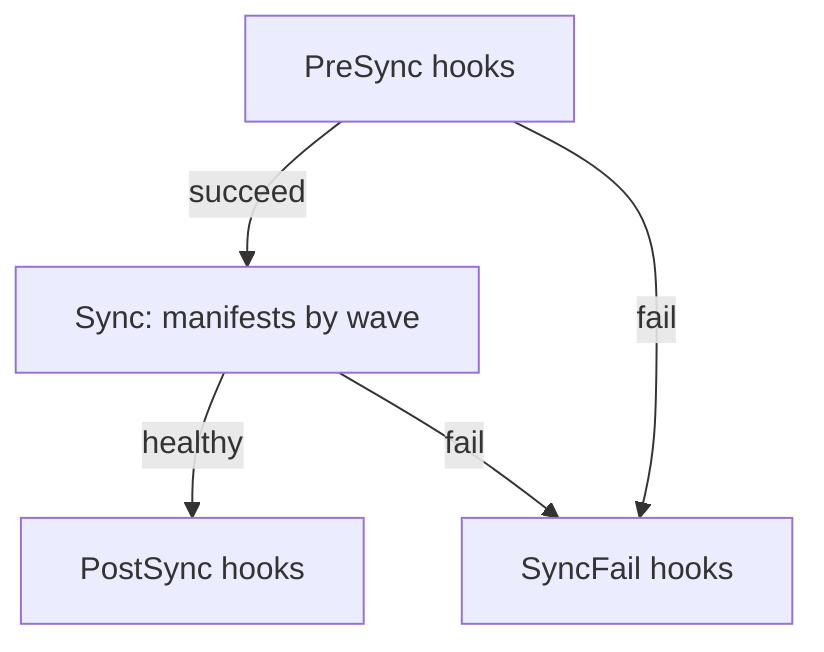

# Sync Phases, Waves And Hooks

When Argo CD applies many objects at once, the order matters. A Deployment that reads a ConfigMap fails if the ConfigMap does not exist yet. A schema migration must end before the application that needs the new schema starts. Kubernetes alone does not order objects that are applied together, so Argo CD adds its own ordering. This part describes the three layers of that ordering: phases, waves and the kind of each object, and then shows how hooks use them.

## Phases

A sync operation moves through phases. The phase of a resource says when in the operation Argo CD handles it. An ordinary manifest belongs to the Sync phase. A hook is a manifest that carries the annotation `argocd.argoproj.io/hook` with the phase it should run in:

- `PreSync` runs before any ordinary manifest is applied. If a PreSync hook fails, the sync stops and nothing is applied.
- `Sync` runs together with the ordinary manifests, after the PreSync hooks succeeded.
- `PostSync` runs after the Sync phase succeeded and the application resources are healthy.
- `SyncFail` runs only when the sync operation fails, and is the place for cleanup or a notification.
- `Skip` tells Argo CD not to apply the manifest at all.

You can list several phases in one annotation, separated by commas. Hooks are usually Kubernetes Jobs, but any resource can be a hook. Argo CD waits for a hook Job to complete and for a hook Pod to finish, and it treats a failed Job as a failed hook.

The diagram shows that a failure in PreSync or Sync leads to the SyncFail hooks and that PostSync runs only after a healthy Sync phase.

## Sync waves

Inside one phase, Argo CD orders objects by wave. The wave is an integer in the annotation `argocd.argoproj.io/sync-wave`. The value is written as a string, such as `"-1"` or `"2"`. An object without the annotation is in wave `0`. Waves can be negative, which lets an object run before everything else.

Argo CD applies the lowest wave first. It waits until every object of a wave is applied and healthy before it starts the next wave, and it adds a short pause of two seconds between waves. An unhealthy object in an early wave therefore blocks later waves. Within a wave, objects are ordered by kind, namespaces before other kinds and custom resources after the built-in kinds, and then by name.

The full precedence is phase first, then wave, then kind, then name. Pruning uses the reverse wave order: objects in higher waves are pruned first.

## Reading the seed example

The path `waves` has these ordered parts:

- `wave-config`, a ConfigMap in wave `-1`, which applies first.
- `wave-app`, a Deployment with no annotation, so wave `0`.
- `wave-app`, a Service with wave `1`, which applies after the Deployment is healthy.
- `wave-presync`, a Job with the hook `PreSync`.
- `wave-postsync`, a Job with the hook `PostSync`.

The expected order of one sync is therefore: the PreSync Job runs and completes, the ConfigMap is applied, the Deployment is applied and becomes healthy, the Service is applied and becomes healthy, and then the PostSync Job runs.

## Hook delete policy

A hook object is a real object in the cluster, so it needs a rule for removal. The annotation `argocd.argoproj.io/hook-delete-policy` sets it:

- `HookSucceeded` deletes the hook after it succeeded.
- `HookFailed` deletes the hook after it failed.
- `BeforeHookCreation` deletes an existing hook with the same name before the new one is created. This is the default when no policy is set.

Both seed Jobs use `HookSucceeded`, so after a successful sync neither Job remains in the namespace. If you see no hook Job after a sync, that is the expected result, not a missing hook. The record of the hook run stays in the operation state.

## Hooks and selective sync

Hooks do not run during a selective sync, which syncs only chosen resources. A sync that you start for one resource therefore skips the migration Job. For a migration that must always run, sync the whole Application.

## Looking at the result

After a sync, the Application status holds the result of every resource and hook in `status.operationState.syncResult.resources`. Each entry has a kind, a name, a sync phase, a wave and a status. Hook entries show the phase `PreSync` or `PostSync`, and ordinary objects show `Sync`. This list is the evidence for the order of a sync, and it stays in the status even when a hook Job was deleted by its policy.

The list also shows which object failed. A failed entry carries a message with the error that the Kubernetes API returned, which is the first thing to read when a sync stops.

## Failure behavior

When a PreSync hook fails, Argo CD stops the operation and runs the `SyncFail` hooks. The Application shows an operation phase of `Failed`. When a later wave contains a manifest that the Kubernetes API rejects, earlier waves stay applied, so a failed sync can leave the cluster in a partly updated state. Design waves so that each wave is safe to leave in place.

## A worked example of a blocked wave

Suppose the Deployment `wave-app` uses an image tag that does not exist. The sync applies the PreSync Job, then the ConfigMap in wave `-1`, then the Deployment in wave `0`. The Deployment object is created, but its pods cannot pull the image, so the Deployment never becomes healthy. Argo CD waits for it and never starts wave `1`, so the Service is not applied and the PostSync Job does not run.

The operation stays in the `Running` phase until the wait ends or someone terminates it. The cluster now holds the ConfigMap and a broken Deployment, but no Service. Reading `syncResult` shows the Deployment as applied and the Service missing, which points straight at the stuck wave.

The fix is a commit that corrects the image. The next sync applies only what differs and continues with the later waves.

## What the part showed

Argo CD orders one sync by phase, wave, kind and name, and it waits for health between waves. Hooks use the same phases and add Jobs before and after the main apply. The open question is how each single object is applied, because applying a large object, a new namespace or a custom resource may need different options.

## Common pitfalls

> [!WARNING]
> The wave annotation value is a string. Write `"1"` with quotes in YAML, or the manifest is invalid. Also, an object that never becomes healthy in wave `0` blocks every later wave and the PostSync hooks, so a sync can look stuck while only one object is unhealthy.
