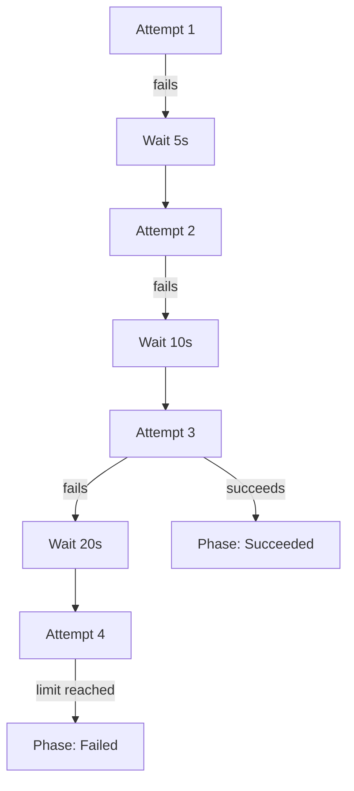

# Sync Retries And Backoff

Some sync failures are temporary. A custom resource definition may be created a few seconds after the objects that use it, an admission webhook may be restarting, or the API server may reject a request while it is busy. If Argo CD gave up at the first error, a person would have to start the sync again by hand. The retry policy lets the sync operation repeat itself. This part explains what a retry repeats, how long Argo CD waits between attempts and why a retry policy is not a way to repair a broken manifest.

## What a failed operation looks like

A sync runs as an operation. The operation is stored in `status.operationState` of the Application, with a `phase`, a `message`, the time it started and finished, and a `syncResult` that lists every resource. The phase is `Running` while the operation works. It ends as `Succeeded` when every resource applied and every hook finished, as `Failed` when an apply or a hook failed, or as `Error` when the controller could not run the operation at all. A sync into a kind that the cluster does not know, for example a `Widget` without a definition, ends as `Failed`.

Without a retry policy a failed operation stays failed. The Application keeps the status `OutOfSync`, the `operationState` keeps the failure message, and nothing happens until the operation is started again, either by a person or by a change in Git.

## The retry block

You enable retries in the sync policy of the Application:

```yaml
spec:
  syncPolicy:
    retry:
      limit: 5
      backoff:
        duration: 5s
        factor: 2
        maxDuration: 3m
```

The field `limit` is the number of retries after the first attempt. The value `-1` means unlimited retries. The `backoff` block sets how long Argo CD waits between attempts. The field `duration` is the base wait before the first retry, `factor` is the number that multiplies the wait after each failed retry, and `maxDuration` caps the wait. The command line flags of `argocd app sync` document the defaults as a base duration of 5 seconds, a factor of 2 and a maximum of 3 minutes.

The retry policy works for manual syncs too. The `argocd app sync` command has the flags `--retry-limit`, `--retry-backoff-duration`, `--retry-backoff-factor` and `--retry-backoff-max-duration` for one operation. The block in the Application is the policy for the syncs that Argo CD starts by itself.

## Calculating the wait

The wait before a retry is the base duration times the factor raised to the number of earlier retries, and never more than the maximum. With a base of 5 seconds and a factor of 2 the waits are 5, 10, 20, 40, 80 and 160 seconds. The next value, 320 seconds, is above the 3-minute maximum, so every later wait is 180 seconds.



The diagram shows a limit of 3: the first attempt plus three retries, with a doubling wait, and the operation ends as `Failed` when the last retry fails. A retry that succeeds ends the operation as `Succeeded`.

The total time matters when you choose the numbers. A limit of 5 with the defaults keeps one failing operation busy for 5 + 10 + 20 + 40 + 80 = 155 seconds of waiting plus the time of each attempt. A limit of `-1` retries without end, so a manifest that can never apply keeps the operation in a loop. Use a finite limit for most Applications.

## Retries and automated sync

Automated sync starts an operation when the Application is `OutOfSync`. It starts at most one operation for each combination of commit SHA and parameters. If that operation fails, automated sync does not start another one for the same commit and parameters. This protects the cluster from a loop of failing syncs.

The retry policy is the way to repeat the same operation. It does not create a new operation. It repeats the one that failed. A new commit in Git is a new combination, so automated sync starts a fresh operation for it, and that operation gets its own retries.

The field `retry.refresh` is an option that makes the retry look at the newest revision of the target branch before each attempt. The default repeats the same revision. Turn it on only when a later commit is expected to fix the failure.

## Reading retry progress

While the operation retries, the phase is `Running` and the field `status.operationState.retryCount` counts the retries. The `message` shows the last error. For an Application named `broken` that syncs the path `broken/unknown-kind`, read the count and the phase with:

<!-- astrona:playground:renew -->

```sh
kubectl -n argocd get application broken -o jsonpath='{.status.operationState.phase}{" "}{.status.operationState.retryCount}{"\n"}'
```

When the limit is reached the phase becomes `Failed`. The `syncResult.resources` list shows which resource failed and its message, which is the place to read the real cause.

## Choosing the numbers

Pick the limit from the longest outage you want to survive. If a webhook needs up to two minutes to restart, the waits of 5, 10, 20, 40 and 80 seconds add up to 155 seconds, so a limit of 5 covers it. If the cause is longer, such as a namespace stuck in termination, a larger `maxDuration` is not the fix. A person should look at the cause instead.

Keep `maxDuration` low enough that a recovered cluster is noticed quickly. A cap of 3 minutes means the next attempt is never more than 3 minutes away once the waits have reached the cap.

## What a retry fixes and what it does not

A retry helps when the failure depends on time or on another object that is still starting. Typical examples are a webhook that is not ready, a namespace that is still terminating, or an object that depends on a definition applied in the same sync. A retry does not help when the manifest is wrong. A `Widget` object with no definition fails on every attempt, and the sync ends as `Failed` after the limit.

Sync waves reduce the need for retries, because waves wait for health between steps. A retry is the fallback for failures that no ordering can predict.

## What the part showed

The retry policy repeats a failed sync operation with a wait that grows by a factor up to a maximum. Automated sync does not repeat a failed operation for the same commit by itself, so the retry block is the way to get repeated attempts. A finite limit keeps a permanent error from looping. The part did not cover when syncs are allowed to start at all. That is the job of sync windows.

## Common pitfalls

> [!WARNING]
> A limit of `-1` retries a permanent error forever and keeps the operation in `Running`. Also, a retry repeats the same revision unless `retry.refresh` is on, so do not rely on retries to pick up a corrected manifest. Read `syncResult.resources` for the real error and fix the cause.
