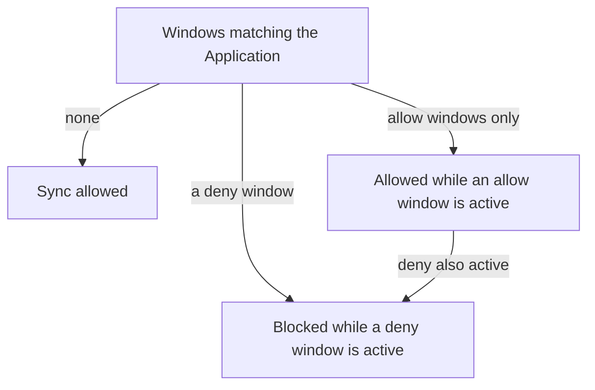

# Sync Windows

Automated sync applies a change as soon as Git has it. For many teams that is too early. A release must not start during a sales event, a database upgrade needs a night with no traffic, and a team may want syncs only inside a maintenance hour. A sync window is the rule that says when syncs may run. This part explains where the rule lives, how allow and deny windows combine, what a window blocks and what the Application looks like while a window is active.

## Where windows live

A sync window belongs to an AppProject, not to an Application. An AppProject is the Argo CD object that groups Applications and limits which repositories, clusters and namespaces they may use. The windows sit in `spec.syncWindows` of the project and apply to every Application that the window selects.

```yaml
apiVersion: argoproj.io/v1alpha1
kind: AppProject
metadata:
  name: maintenance
  namespace: argocd
spec:
  sourceRepos:
  - '*'
  destinations:
  - server: https://kubernetes.default.svc
    namespace: '*'
  syncWindows:
  - kind: deny
    schedule: '0 8 * * *'
    duration: 10h
    applications:
    - '*'
    manualSync: true
```

Each window has these fields:

- `kind` is `allow` or `deny`.
- `schedule` is a cron expression with five fields (minute, hour, day of month, month, day of week). It says when the window starts.
- `duration` says how long the window stays active after each start, for example `1h` or `10h`.
- `applications`, `namespaces` and `clusters` are lists of selectors. Wildcards work. A window applies to an Application when any selector matches it.
- `manualSync: true` lets a person start a sync while the window is active.
- `timeZone` sets the time zone of the schedule, for example `Europe/Amsterdam`. Without it the schedule uses UTC.
- `syncOverrun: true` lets a sync that already runs continue past the end of the window.

## How the kinds combine

The rules for one Application follow from the windows that match it.



With no matching window every sync is allowed. If a matching `allow` window exists, syncs are allowed only while an `allow` window is active, and blocked the rest of the time. If a matching `deny` window exists, syncs are blocked while it is active. When an `allow` and a `deny` window are active together, `deny` wins.

The schedule `0 8 * * *` with a duration of `10h` starts each day at 08:00 and ends at 18:00. A deny window with that schedule blocks syncs during office hours and allows them in the evening and at night. An allow window with the same schedule does the opposite: syncs run only from 08:00 to 18:00.

## What a window blocks

A window affects manual and automated syncs. When a window blocks an Application, the controller does not start an automated sync, and a manual sync request is refused. The option `manualSync: true` changes only the manual path. With it, a person with the right permission can still sync during the window, and the controller still skips the automated sync. This is the usual setting when you want to stop unattended changes and still allow an emergency fix.

A window does not stop Argo CD from comparing. The controller keeps fetching Git and comparing it with the cluster. An Application whose sync is blocked still shows `OutOfSync` when Git differs from the cluster. The Application is not marked as failed and no operation starts. The difference is visible, but it is not applied.

The command `argocd app get NAME` prints the sync window state and the windows assigned to the Application. In the web interface the sync panel colors it red when syncs are denied, orange when only manual syncs are allowed and green when syncs are allowed.

## A window for a group of Applications

The selectors let one window cover many Applications. The entry `applications: ['*-prod']` matches every Application whose name ends in `-prod`. The entry `namespaces: [starfleet]` matches every Application that deploys into the namespace `starfleet`. The entry `clusters: [in-cluster]` matches the cluster that Argo CD runs in. When you set more than one selector in the same window, they are combined with OR by default. A window with `applications: ['alpha']` and `namespaces: ['starfleet']` therefore matches `alpha` and also every Application in `starfleet`.

The web interface offers an option to combine the selectors with AND instead. If you rely on the YAML only, use one selector that identifies the group, for example a naming convention for the Application names, so that the match does not depend on how several selectors combine.

A project can hold several windows at the same time. A common layout is one `allow` window for the weekly release hour and one `deny` window for a month-end freeze. The `deny` window wins whenever both are active, so the freeze needs no change to the release window.

## Windows do not change what a sync does

A window answers one question: may a sync start now? It does not change how objects are applied, ordered or pruned, and it does not queue a sync for later. When a deny window ends, the controller notices that the Application is still `OutOfSync` and starts the automated sync, because the conditions are met again. If automated sync is off, nothing starts until a person syncs.

Because the window lives in the project, a team that can edit its Applications cannot remove the window unless it can also edit the project. This is the point of putting windows in the project: platform owners set the rule once for all Applications in it.

## What the part showed

Sync windows are allow and deny rules with a cron schedule and a duration, stored in an AppProject and matched to Applications with selectors. They block automated and manual syncs, with `manualSync` as the exception for people, and a blocked Application stays `OutOfSync` instead of failing. What remains is how to return to an earlier revision when a sync that was allowed turns out to be bad.

## Common pitfalls

> [!WARNING]
> A `deny` window with `manualSync: true` still blocks automated sync, which is often the goal, but a person can bypass it. Also, a window with several selectors matches on any one of them, so `namespaces: [starfleet]` blocks more Applications than you may expect. Check the schedule time zone: without `timeZone` the schedule uses UTC.
