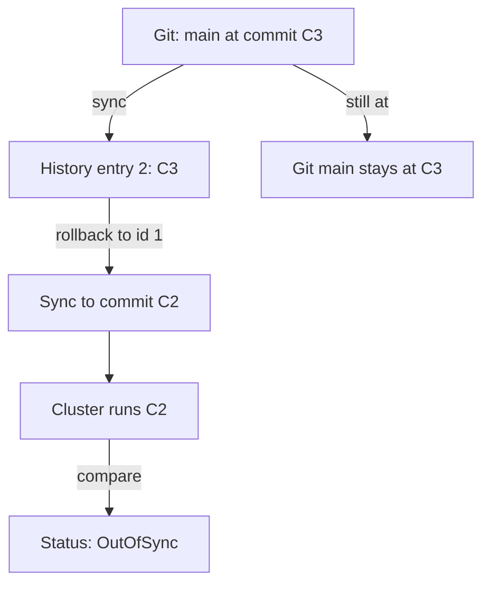

# Deployment History And Rollback

A release can pass every check and still fail in production. The quickest way to restore service is often to run the last version that worked. Argo CD records every successful sync, so it can do that without a new commit. This part explains what the history holds, how a rollback uses it, why a rollback is refused while automated sync is on, and why the state after a rollback is `OutOfSync`.

## What the history holds

Each successful sync operation adds an entry to the list `status.history` of the Application. An entry holds an `id`, the `revision` that was deployed, the `deployedAt` and `deployStartedAt` times, the `source` that was used and who started the sync in `initiatedBy`. The id grows with each entry, so the entry with the highest id is the most recent sync.

Argo CD keeps a limited number of entries. The field `spec.revisionHistoryLimit` sets the limit, and the default is 10. When the list is full, the oldest entry is removed. A revision that is older than ten successful syncs cannot be a rollback target.

The history stores the revision and the source, not the rendered manifests. A rollback renders the manifests again from the stored revision. The Git server therefore must still hold that commit. If someone rewrites the branch and removes the commit, the rollback fails because Argo CD cannot fetch it.

Read the history with the command line or with `kubectl`:

<!-- astrona:playground:renew -->

```sh
argocd app history release-train --core
kubectl -n argocd get application release-train -o jsonpath='{range .status.history[*]}{.id}{" "}{.revision}{"\n"}{end}'
```

The first command prints one line per entry with its id, date and revision. The second prints the id and the full commit SHA of each entry.

## What a rollback does

A rollback is a sync with the source of an old history entry. The command is `argocd app rollback NAME ID`, where `ID` is the history id. Without an id the command rolls back to the previous entry. The command syncs the Application to the stored revision and applies the manifests that this revision renders. The flag `--prune` deletes objects that the old revision does not contain.



The diagram shows that the rollback changes the cluster and leaves Git alone. The rollback itself is a sync, so it adds a new entry to the history, with the old revision.

## Choosing a recovery path

There are three ways to leave a bad release, and each fits a different situation.

- Roll back when service is down and you need the previous version now. It is fast, needs no commit and leaves the Application `OutOfSync`.
- Revert in Git when the bad commit is known. The next sync deploys the reverted state, the Application becomes `Synced` and the history shows the recovery as a normal sync.
- Sync to a revision when you want a specific tag or commit that is not in the history, for example the last tag before a release.

A rollback needs a history entry that matches the version you want. If the Application changed its source between syncs, for example from one path to another, the entry still holds its own source, so the rollback restores that source for the sync. Check the entry with `kubectl` before you roll back, because the id alone does not tell you what the revision contained.

## Why automated sync blocks a rollback

Argo CD refuses a rollback for an Application with automated sync enabled. The reason is the loop that would follow. The rollback makes the cluster differ from the head of the branch. Automated sync sees an `OutOfSync` Application and applies the head again, so the rollback would last only until the next comparison.

To roll back you first turn automated sync off. Set `spec.syncPolicy.automated.enabled` to `false`, or remove the `automated` block. Then run the rollback. Automated sync stays off until a person turns it on again.

## The state after a rollback

After the rollback the Application is `OutOfSync` and stays so. The target revision of the Application still points at the head of the branch, and the head contains the change you wanted to leave. The comparison shows the difference between the rolled-back cluster and the head, which is correct. The status is a reminder that the cluster does not match Git.

The rollback is an emergency measure. It buys time while you fix the cause. The lasting fix is a commit in Git: a revert of the bad commit, or a corrected change. When that commit exists you sync again, the Application becomes `Synced` and you can turn automated sync back on. A rollback that you forget leaves the Application out of sync with Git.

## Syncing to a specific revision

A rollback is not the only way to deploy an old revision. The command `argocd app sync NAME --revision REVISION` syncs the Application to any branch, tag or commit and keeps the parameter overrides. The sync is recorded in the history like any other. Use it to try a revision that was never deployed. Use a rollback to return to one that was.

The `targetRevision` of the Application does not change in either case. It changes only when you edit the Application or use `argocd app set`.

## Rollback and sync windows

A rollback is a sync that a person starts, so it follows the rules for manual syncs. If a deny window is active for the Application and the window does not set `manualSync: true`, the rollback is refused until the window ends. For this reason, a project that freezes releases normally keeps `manualSync: true` on its deny windows. Without it, a team that needs an emergency rollback has to edit the project first.

## Reading what a rollback changed

After a rollback, read the Application in the same way as after any sync. The field `status.operationState.syncResult.revision` holds the commit that the operation applied, and `status.sync.revision` holds the commit that the comparison used. After a rollback the first one shows the old commit and the second one shows the head of the branch. The two values differ, and the difference explains the `OutOfSync` status. Compare the two values with `kubectl` and write the result in the incident record, so that the next person knows which commit runs and which commit Git holds.

Check the workload as well, for example the replica count of a Deployment, because it shows whether the old version is running.

## Multiple sources

An Application can have several sources. In that case each history entry stores a list of revisions, one for each source, and a rollback restores all of them together. This keeps a chart and its values file at the versions that worked as a set.

## What the part showed

The history is a list of successful syncs with their revisions. A rollback syncs the Application to one of those revisions, needs automated sync off and leaves the Application `OutOfSync`, because Git still holds the newer commit. The part did not show the three controls together. The next part runs them in the playground.

## Common pitfalls

> [!WARNING]
> A rollback fails while automated sync is on, and a rollback target is lost once more than `revisionHistoryLimit` newer syncs exist. Do not treat the `OutOfSync` status after a rollback as an error. Treat it as the reminder to fix Git, and do not turn automated sync back on before Git holds the fix, because the controller would deploy the bad head again.
