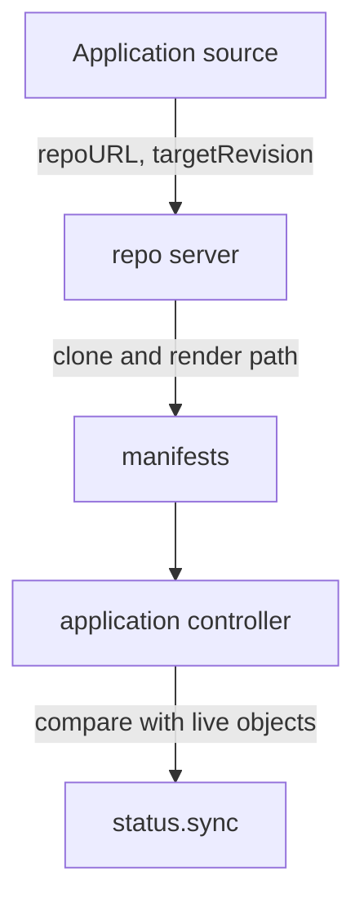

# Application Source, Destination And Project Boundaries

Kubernetes accepts any object that you send to its API, from anywhere, to any namespace you have rights for. A delivery tool that works from Git needs more precision. It must know which repository, which revision and which folder it reads, and which cluster and namespace it writes to. The Argo CD Application holds exactly these answers in three fields: `source`, `destination` and `project`. This part explains what each field selects, which Argo CD component uses it and where the fields stop selecting.

## The Application is a Kubernetes object

An Application is a custom resource of the group `argoproj.io`. It lives in the `argocd` namespace by default. Two Argo CD components work on it. The application controller watches Applications, compares the desired state with the live state and starts sync operations. The repo server (the component `argocd-repo-server`) is a separate service that clones the Git repository and renders the manifests, and the controller asks it for the result. The `source` field is mostly an instruction for the repo server. The `destination` field is mostly an instruction for the application controller.

## Source: what is read

The `source` block names the repository and the place in it. The field `repoURL` is the address of the Git repository. The field `path` is the folder that holds the manifests. The field `targetRevision` is the branch, tag or commit that the repo server reads. When you leave it out, Argo CD uses `HEAD`, the default branch.

A branch name moves. Every new commit on `main` changes what `main` means. The repo server therefore resolves `targetRevision` to a full commit SHA (the 40-character identifier that Git gives every commit) each time it renders, and the Application records the result in `status.sync.revision`. A tag is stable by convention, but Git allows someone to move it. Only a full commit SHA never changes. A reviewer who needs to know exactly what was deployed reads `status.sync.revision`, not `targetRevision`.



The diagram shows that the repo server turns the source fields into manifests and the application controller compares those manifests with the cluster.

## Destination: where it goes

The `destination` block names a cluster and a namespace. A cluster is identified in one of two ways. The field `server` holds the API server URL, for example `https://kubernetes.default.svc`, which is the cluster that Argo CD itself runs in. The field `name` holds the name that the cluster has in the Argo CD cluster list, and the cluster list for the local cluster calls it `in-cluster`. An Application uses `server` or `name`, not both.

The field `namespace` is a default. The application controller applies it to namespaced objects whose manifest has no namespace. It does not change a namespace that the manifest sets itself. The seed manifests write `namespace: starfleet` in every object. An Application with the destination namespace `outpost` that syncs those manifests still creates the objects in `starfleet`. The destination is therefore a statement of intent that you must also check against the rendered manifests.

## Project: what is allowed

The `project` field names an AppProject. It is a second object in the `argocd` namespace that lists the repositories, clusters, namespaces and kinds that its Applications may use. An Application with no `project` field uses the project `default`. That project allows every repository, every cluster, every namespace and every cluster-scoped kind, so it restricts nothing. The next part covers the restrictions in detail. The point here is that the Application names its project itself, so a project restricts only the Applications that belong to it and only as long as the people who can edit an Application cannot move it to a laxer project.

## Reading the fields on a live Application

Reading the fields is the fastest way to understand an unknown Application. Save this as `application-source-demo.yaml`:

<!-- astrona:playground:renew -->

```yaml
apiVersion: argoproj.io/v1alpha1
kind: Application
metadata:
  name: source-demo
  namespace: argocd
spec:
  project: default
  source:
    repoURL: http://git-source.argocd.svc:8080/repo.git
    targetRevision: main
    path: plain
  destination:
    server: https://kubernetes.default.svc
    namespace: starfleet
```

Apply it:

```sh
kubectl apply -f application-source-demo.yaml
```

The Application has no sync policy, so Argo CD compares and does not deploy. Then check the result:

```sh
kubectl -n argocd get application source-demo -o jsonpath='{.status.sync.status}{"\n"}{.status.sync.revision}{"\n"}'
```

The first line is `OutOfSync` because the objects do not exist yet. The second line is the 40-character commit SHA that `main` pointed to when the repo server rendered the path. Now switch the revision to the branch `release`, where the `plain` path has three replicas:

```sh
kubectl -n argocd patch application source-demo --type merge -p '{"spec":{"source":{"targetRevision":"release"}}}'
kubectl -n argocd get application source-demo -o jsonpath='{.status.sync.revision}{"\n"}'
```

The SHA changes after the next refresh, which can take a few seconds. Nothing in the cluster changed, because the Application has no sync policy. Only the desired state changed.

## What the fields do not select

Three limits are worth remembering. The `path` selects a folder, and the tool that renders it (plain directory, Helm or Kustomize) can pull in files from outside the folder, so the path alone does not list every file that influences the result. The `destination.namespace` does not rewrite explicit namespaces. And the `project` is only as strong as the control over who can edit Applications and the repository. A person who can push to the repository path can change what the Application deploys, within the limits of the project.

## What the part showed

An Application selects Git content with `repoURL`, `targetRevision` and `path`, and the repo server resolves that to a commit SHA in `status.sync.revision`. It selects a cluster with `server` or `name` and a default namespace with `namespace`. It joins a project through the `project` field. The part did not explain how a project restricts these choices or how Argo CD reports a refusal.

## Common pitfalls

> [!WARNING]
> Do not read `targetRevision` as the deployed version: a branch or tag can move, so read `status.sync.revision`. Do not assume `destination.namespace` moves objects whose manifests name a namespace. Do not treat `default` as a safe project: it allows everything.
