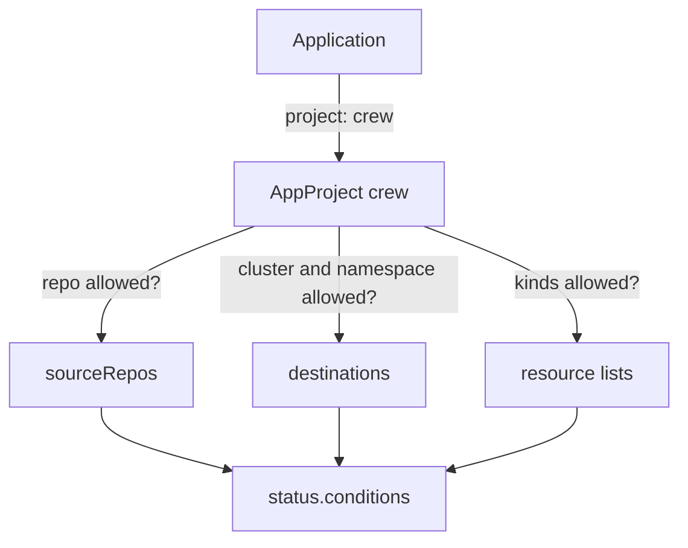

# AppProject Restrictions

An Application chooses its own source and destination. If nothing limited those choices, anyone who can create an Application could deploy any repository to any namespace of any cluster Argo CD can reach. The AppProject is the object that limits them. This part explains the restriction fields, which ones are allow lists and which are deny lists, when Argo CD checks them and how a violation shows up on the Application.

## What an AppProject is

An AppProject is a custom resource in the `argocd` namespace. Every Application belongs to one. The project holds lists of what its Applications may use. Argo CD checks an Application against its project whenever the application controller or the API server handles it. The project is a rule set inside Argo CD. It does not replace Kubernetes authorization: Argo CD still applies objects with its own service account, and Kubernetes decides what that account may do.

The project `default` exists from the start and cannot be deleted. Its spec allows every repository, every destination and every cluster-scoped kind, and it has no namespaced kind restriction. That is why a first Application in `default` always works.

## Source repositories

The field `sourceRepos` is a list of repository URLs that Applications in the project may use. A value of `'*'` allows every repository. A pattern with `*` allows a family of addresses. An entry that starts with `!` denies a repository. A source is valid when at least one entry allows it and no `!` entry rejects it.

```yaml
spec:
  sourceRepos:
  - http://git-source.argocd.svc:8080/repo.git
```

This list allows only the internal Git server. An Application that points at any other repository is refused.

## Destinations

The field `destinations` is a list of pairs of cluster and namespace. Each entry has a `server` and a `namespace`. Wildcards work in both values, and `!` denies a match. Argo CD matches the cluster by the server URL, so a `name` in the Application destination is first looked up in the cluster list and the resulting URL is compared with the project.

```yaml
spec:
  destinations:
  - server: https://kubernetes.default.svc
    namespace: starfleet
```

This entry allows the local cluster and only the namespace `starfleet`. An Application whose destination namespace is `outpost` is refused. Note that the check compares the Application destination. It does not read the namespaces inside the manifests.

## Resource kinds

Four lists restrict kinds. They differ in whether they allow or deny.

- `clusterResourceWhitelist` allows the listed cluster-scoped kinds, such as `Namespace`. A cluster-scoped kind that is not on the list is refused. An empty list refuses every cluster-scoped kind.
- `clusterResourceBlacklist` denies the listed cluster-scoped kinds.
- `namespaceResourceBlacklist` denies the listed namespaced kinds. By default every namespaced kind is allowed.
- `namespaceResourceWhitelist` allows only the listed namespaced kinds when it is set.

Each entry has a `group` and a `kind`. The core group is the empty string, so a Service is `group: ''` with `kind: Service`, and a Deployment is `group: apps` with `kind: Deployment`.

```yaml
spec:
  namespaceResourceWhitelist:
  - group: apps
    kind: Deployment
  - group: ''
    kind: Service
```

With this list an Application in the project can sync Deployments and Services and nothing else that is namespaced. A ConfigMap in the same path would be refused. The restriction on cluster-scoped kinds matters most, because a cluster-scoped kind such as a `ClusterRole` can give broad rights.

## When Argo CD checks and what it reports

Argo CD checks the source and the destination when the Application is created or changed and again on each reconciliation. It checks resource kinds when it compares and syncs the rendered objects. A violation does not block `kubectl apply` of the Application itself, because the Application is a valid Kubernetes object. The application controller sets a condition instead.



The diagram shows that the project checks three things and that a refusal ends in `status.conditions` of the Application.

Read the conditions with this command, which prints the type and the message of each one:

<!-- astrona:playground:renew -->

```sh
kubectl -n argocd get application NAME -o jsonpath='{range .status.conditions[*]}{.type}{": "}{.message}{"\n"}{end}'
```

Replace `NAME` with the Application name. A refused source or destination appears as a condition of type `InvalidSpecError`, and the message names the project and the refused value. When the project allows everything, the list is empty. The condition is the first place to look when an Application does not sync and its operation shows nothing.

## What a project does not do

A project does not give Argo CD any right it lacks. If the project allows the namespace `starfleet` but the Argo CD service account has no right to create Deployments there, the sync fails with a Kubernetes authorization error. The opposite is also true. Kubernetes authorization allows what the service account may do everywhere, and the project narrows what each group of Applications may ask for. The two layers work together, and neither replaces the other.

A project also does not control who edits the Application or the repository. The `roles` field gives people and tokens rights over the project's Applications, and Argo CD RBAC (role based access control) decides who may create Applications in it. Those controls belong to access management and are separate from the restriction lists.

## What the part showed

An AppProject holds `sourceRepos`, `destinations` and four kind lists. Argo CD checks an Application against them and reports a violation as a condition on the Application. The project narrows what Applications may request and leaves Kubernetes authorization in place. The remaining question is how to prove the limits work on a live Application.

## Common pitfalls

> [!WARNING]
> A `namespaceResourceWhitelist` that is set allows only the kinds it names, and without it every namespaced kind is allowed. A cluster-scoped kind that is missing from `clusterResourceWhitelist` is refused. The project checks the Application destination, not the namespace written inside the manifests.
