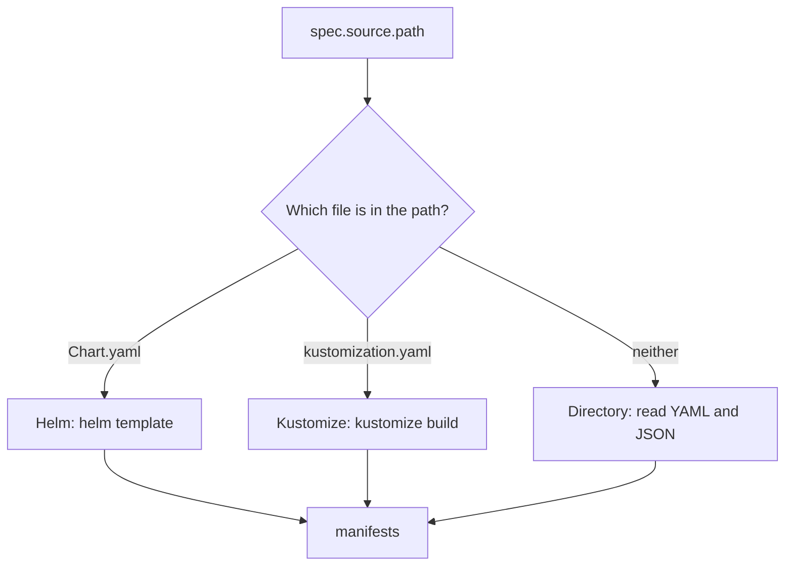

# Directory, Helm And Kustomize Sources

Argo CD does not apply a Git folder as it is. It first turns the folder into a list of Kubernetes manifests, and the way it does that depends on what the folder contains. A folder of YAML files needs no tool. A Helm chart needs the `helm template` command. A Kustomize base needs `kustomize build`. This part explains how the repo server picks the tool, what each tool produces and which options each source type offers.

## The repo server renders, the controller compares

The repo server (the component `argocd-repo-server`) clones the repository at the revision of the Application and runs the rendering tool in the folder named by `spec.source.path`. It returns a list of manifests. The application controller compares that list with the live objects. The cluster never sees Helm or Kustomize. The result is always plain manifests, and Argo CD applies those itself.

This matters for Helm in particular. Argo CD uses Helm only to inflate a chart with `helm template`. It does not run `helm install`, it creates no Helm release and `helm list` shows nothing. The lifecycle of the objects belongs to Argo CD.

## How the tool is chosen

Argo CD looks at the files in the path. If the folder has a `Chart.yaml`, it is a Helm chart. If it has a `kustomization.yaml`, it is a Kustomize base. If it has neither, it is a directory of plain manifests. The Application records the result in `status.sourceType` as `Helm`, `Kustomize` or `Directory`.



The diagram shows the detection and that every source type ends as the same list of manifests.

The seed repository shows a trap. The path `plain` contains a `kustomization.yaml` that lists `app.yaml`, so Argo CD treats `plain` as Kustomize even though it looks like plain files. The path `workloads/alpha` has only `app.yaml` and is a directory source.

## Directory sources

A directory source reads the files with the extensions `.yaml`, `.yml` and `.json` in the folder. It does not read subfolders unless you set `directory.recurse: true`. The options `include` and `exclude` take glob patterns that select files, and a file must match `include` and must not match `exclude`.

```yaml
spec:
  source:
    path: workloads/alpha
    directory:
      recurse: true
      exclude: 'notes.yaml'
```

You do not need the `directory` block unless you want one of these options. A warning from the documentation: if the block is set and Argo CD finds Helm or Kustomize files, rendering fails.

## Helm sources

A Helm source is a chart in a Git path (`path` set) or in a Helm repository (`chart` set, with a `repoURL` that is a Helm repository). For a chart stored in Git, you set `path` and you do not set `chart`. Argo CD runs `helm template` with the Application name as the release name, unless `helm.releaseName` sets another one. Values come from the chart's `values.yaml`, from `valueFiles`, from `values` or `valuesObject` and from `parameters`. The second part covers how these combine.

## Kustomize sources

A Kustomize source is a folder with a `kustomization.yaml`. The base lists resources and the overlay changes them. In the seed repository `kustomize/overlays/dev` takes `kustomize/base` and adds the name prefix `dev-`, a label and one replica. Argo CD runs `kustomize build` in the path. The Application block `spec.source.kustomize` adds overrides on top of the kustomization file.

## Seeing the detection on live Applications

Save this as `applications-sources.yaml`. It holds three Applications, one for each source type, and none of them syncs:

<!-- astrona:playground:renew -->

```yaml
apiVersion: argoproj.io/v1alpha1
kind: Application
metadata:
  name: src-directory
  namespace: argocd
spec:
  project: default
  source:
    repoURL: http://git-source.argocd.svc:8080/repo.git
    targetRevision: main
    path: workloads/alpha
  destination:
    server: https://kubernetes.default.svc
    namespace: starfleet
---
apiVersion: argoproj.io/v1alpha1
kind: Application
metadata:
  name: src-helm
  namespace: argocd
spec:
  project: default
  source:
    repoURL: http://git-source.argocd.svc:8080/repo.git
    targetRevision: main
    path: chart
  destination:
    server: https://kubernetes.default.svc
    namespace: starfleet
---
apiVersion: argoproj.io/v1alpha1
kind: Application
metadata:
  name: src-kustomize
  namespace: argocd
spec:
  project: default
  source:
    repoURL: http://git-source.argocd.svc:8080/repo.git
    targetRevision: main
    path: kustomize/overlays/dev
  destination:
    server: https://kubernetes.default.svc
    namespace: starfleet
```

Apply it:

```sh
kubectl apply -f applications-sources.yaml
```

Then check the result. This command prints the detected type and the sync status of each Application:

```sh
kubectl -n argocd get applications -o custom-columns=NAME:.metadata.name,TYPE:.status.sourceType,SYNC:.status.sync.status
```

The types should be `Directory` for `src-directory`, `Helm` for `src-helm` and `Kustomize` for `src-kustomize`, and all three are `OutOfSync` because none of the objects exists. Read the container images that each source renders:

```sh
kubectl -n argocd get application src-helm -o jsonpath='{.status.summary.images}{"\n"}'
```

The list should hold `docker.io/library/python:3.13-alpine`, which is the image in the chart's `values.yaml`.

## What the part showed

The repo server detects the source type from `Chart.yaml` or `kustomization.yaml`, renders plain manifests and returns them to the controller. Argo CD uses Helm only as a template engine. The open question is how an Application changes the rendered result without a commit, and how it avoids fighting with other controllers over live fields.

## Common pitfalls

> [!WARNING]
> A path with a `kustomization.yaml` is a Kustomize source even if it looks like a plain folder. Do not set `chart` for a chart that lives in Git. Do not expect `helm list` to show anything: Argo CD never creates a Helm release.
