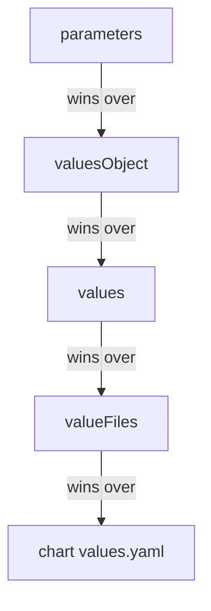

# Helm And Kustomize Parameter Overrides

One chart or one Kustomize base usually serves several environments. The usual way to tell them apart is to keep a values file or an overlay for each one in Git. Argo CD adds a second way: the Application itself can carry overrides, which the repo server applies when it renders. This part explains the override fields for Helm and for Kustomize, the order in which Helm values combine, and what it costs to keep overrides outside Git.

## Where an override lives

The overrides are fields in the Application under `spec.source.helm` or `spec.source.kustomize`. The repo server reads them together with the Git path and runs the tool with them. A change to an override changes the rendered manifests, so the application controller compares again and the Application becomes `OutOfSync` until a sync applies the new result. No commit is needed, and the repository does not show the change. That is useful for a one-time change and risky for anything permanent, because the Application object becomes a second source of truth.

## Helm values in four places

The block `spec.source.helm` has four fields that set values. Together with the `values.yaml` file of the chart, they form five sources.

- `valueFiles` is a list of values files inside the repository path, such as `values-prod.yaml`. Argo CD passes them to Helm as `--values`. When the list has several files, the last one wins on a conflict.
- `values` is a block of YAML written as a string inside the Application.
- `valuesObject` is the same content written as a native YAML map, which is easier to read and to patch.
- `parameters` is a list of single values, each with a `name` and a `value`. It behaves like `helm template --set`. The name uses dots for nesting, such as `image.tag`.
- `values.yaml` of the chart gives the defaults.

The documented precedence from strongest to weakest is `parameters`, then `valuesObject`, then `values`, then `valueFiles`, then the `values.yaml` of the chart. If both `values` and `valuesObject` are set, `valuesObject` wins and `values` is ignored.



The diagram shows the order in which Helm values override each other, with `parameters` the strongest.

A worked case with the seed chart. The chart's `values.yaml` sets `replicas: 2`. The file `values-prod.yaml` sets `replicas: 3`. An Application with `valueFiles: [values-prod.yaml]` renders three replicas. If the same Application also sets `valuesObject` with `replicas: 4`, it renders four. If it also sets a parameter `replicas` with the value `5`, it renders five. Each stronger source replaces the value of the weaker one, and values that only a weaker source sets stay as they are.

## Kustomize overrides

The block `spec.source.kustomize` changes a Kustomize result without editing the kustomization file. The documented fields include these.

- `namePrefix` and `nameSuffix` replace the prefix and suffix of the kustomization file.
- `namespace` makes Kustomize set the namespace of all objects.
- `images` is a list of image overrides, written as `image-name:tag`, such as `docker.io/library/python:3.11-alpine`. Kustomize replaces the tag of every image with that name.
- `replicas` is a list of entries with a `name` and a `count`.
- `commonLabels` and `commonAnnotations` add labels and annotations to every object.

Names matter in these fields. With the seed overlay `kustomize/overlays/prod`, which sets the prefix `prod-`, an Application that sets `namePrefix: ops-` renders the Deployment name `ops-git-probe`, because the Application value replaces the value of the file.

## A worked override

Save this as `application-override-demo.yaml`. It renders the `prod` overlay with a different prefix and an older image tag, and it does not sync:

<!-- astrona:playground:renew -->

```yaml
apiVersion: argoproj.io/v1alpha1
kind: Application
metadata:
  name: override-demo
  namespace: argocd
spec:
  project: default
  source:
    repoURL: http://git-source.argocd.svc:8080/repo.git
    targetRevision: main
    path: kustomize/overlays/prod
    kustomize:
      namePrefix: ops-
      images:
      - docker.io/library/python:3.11-alpine
  destination:
    server: https://kubernetes.default.svc
    namespace: starfleet
```

Apply it:

```sh
kubectl apply -f application-override-demo.yaml
```

Then check the result. The Application status lists the images that the render produced:

```sh
kubectl -n argocd get application override-demo -o jsonpath='{.status.summary.images}{"\n"}'
```

The list should hold `docker.io/library/python:3.11-alpine` and not `3.12-alpine`, which the overlay sets. To read the rendered Deployment name, use the `argocd` command line client in core mode, which talks to the cluster through `kubectl` and needs the `argocd` namespace in the context:

```sh
kubectl config set-context --current --namespace=argocd
argocd app manifests override-demo --core | grep -E 'name: ops|image:'
```

You should see `ops-git-probe` for the Deployment and the Service and the 3.11 image.

## The cost of overrides

An override keeps the Git folder simple, and it hides a decision outside review. A person who reads only the repository sees the base values. Overrides in the Application are also lost when someone recreates the Application from another manifest. Use them for values that belong to the Application, such as the image tag of a release or the release name, and keep environment differences in Git as values files or overlays.

## What the part showed

Helm values combine in a fixed order with `parameters` strongest and the chart defaults weakest. Kustomize overrides replace fields of the kustomization file. Both are applied by the repo server and change only the rendered manifests. The remaining problem is that other controllers change live fields on purpose, and the comparison reports those fields as differences.

## Common pitfalls

> [!WARNING]
> A parameter beats `valuesObject`, so an old parameter can hide a value you change in a values file. Parameter values are strings in the Application. Kustomize `images` replaces the tag of every container with that image name, not of one container. Overrides live in the Application and are not in Git.
