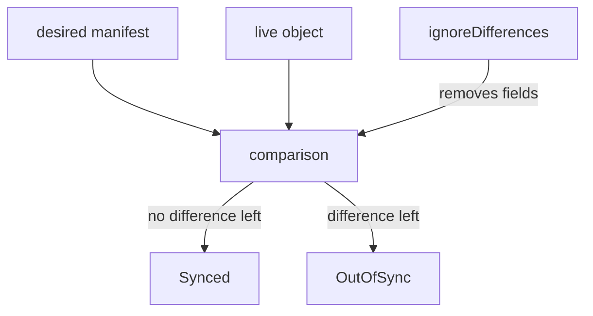

# Ignoring Expected Differences With ignoreDifferences

Argo CD reports an Application as `OutOfSync` when a live object differs from the desired manifest. Some differences are expected. A HorizontalPodAutoscaler (a controller that changes the replica count of a Deployment from load measurements) changes `spec.replicas` all day. A webhook adds a certificate to a configuration object. If Argo CD treats these changes as drift, the Application is always `OutOfSync`, and with `selfHeal` Argo CD keeps undoing the work of the other controller. The field `ignoreDifferences` removes such fields from the comparison. This part explains how to select them, what changes during a sync and what stays risky.

## What the comparison does

The application controller compares the desired manifest and the live object field by field. A field that exists only in the live object because Kubernetes defaulted it is not a difference. A field that the desired manifest sets and the live object holds with another value is a difference. The Application is `OutOfSync` when at least one managed object has a difference. With automated sync and `selfHeal`, the controller then applies the desired state again.

## The ignoreDifferences block

The block lives in `spec.ignoreDifferences` of the Application as a list. Each entry selects objects and fields.

- `group` and `kind` select the objects by API group and kind. The `group` is the API group without the version, such as `apps` for a Deployment.
- `name` and `namespace` narrow the selection to one object. When they are left out, the entry applies to every object of the kind.
- `jsonPointers` is a list of JSON Pointer paths to fields, such as `/spec/replicas`.
- `jqPathExpressions` is a list of jq expressions, for cases a pointer cannot reach, such as an element in a list that has a given name.
- `managedFieldsManagers` is a list of field manager names. Fields that one of those managers owns are ignored. A field manager is the name that Kubernetes records for the client that last wrote a field.

```yaml
spec:
  ignoreDifferences:
  - group: apps
    kind: Deployment
    jsonPointers:
    - /spec/replicas
  - group: admissionregistration.k8s.io
    kind: MutatingWebhookConfiguration
    jqPathExpressions:
    - '.webhooks[]?.clientConfig.caBundle'
```

The first entry ignores the replica count of every Deployment. The second ignores the certificate bundle of every webhook in a mutating webhook configuration.



The diagram shows that `ignoreDifferences` removes fields before the comparison decides between `Synced` and `OutOfSync`.

## System-wide rules

The same rules can apply to every Application. The ConfigMap `argocd-cm` holds keys such as `resource.customizations.ignoreDifferences.all` for all kinds or `resource.customizations.ignoreDifferences.admissionregistration.k8s.io_MutatingWebhookConfiguration` for one kind. Administrators of the Argo CD installation use them. An Application-level entry is the right tool for one team.

## ignoreDifferences and a sync

The default `ignoreDifferences` affects only the comparison. When a sync runs for another reason, Argo CD applies the desired manifest as it is, and that sync writes the ignored field too. A sync that you start while a Deployment has five replicas and the desired manifest has three sets the replicas back to three. To keep the ignored field out of the sync as well, add the sync option `RespectIgnoreDifferences=true`. Argo CD then removes the ignored fields from the desired state before it applies it. The option works only for objects that already exist in the cluster. A new object is created with the desired manifest as it is.

```yaml
spec:
  syncPolicy:
    syncOptions:
    - RespectIgnoreDifferences=true
```

With `selfHeal`, an ignored difference does not make the Application `OutOfSync`, so the controller does not start a repair for it. A repair for another field can still apply the full manifest unless the option is set.

## Watching an ignored field

Save this as `application-ignore-demo.yaml`. The Application syncs the path `workloads/beta`, which has one replica, and ignores the replica count of Deployments:

<!-- astrona:playground:renew -->

```yaml
apiVersion: argoproj.io/v1alpha1
kind: Application
metadata:
  name: ignore-demo
  namespace: argocd
spec:
  project: default
  source:
    repoURL: http://git-source.argocd.svc:8080/repo.git
    targetRevision: main
    path: workloads/beta
  destination:
    server: https://kubernetes.default.svc
    namespace: starfleet
  ignoreDifferences:
  - group: apps
    kind: Deployment
    jsonPointers:
    - /spec/replicas
  syncPolicy:
    automated:
      selfHeal: true
```

Apply it:

```sh
kubectl apply -f application-ignore-demo.yaml
kubectl -n argocd wait --for=jsonpath='{.status.sync.status}'=Synced application/ignore-demo --timeout=240s
```

Then change the live replica count by hand and check the result after a short pause:

```sh
kubectl -n starfleet scale deployment beta --replicas=3
kubectl -n argocd get application ignore-demo -o jsonpath='{.status.sync.status}{"\n"}'
kubectl -n starfleet get deployment beta -o jsonpath='{.spec.replicas}{"\n"}'
```

The Application should stay `Synced` and the Deployment should keep `3` replicas. Without the `ignoreDifferences` entry the Application would show `OutOfSync` and `selfHeal` would set the replicas back to `1`.

## What the part showed

The field `ignoreDifferences` selects objects by group, kind, name and namespace and removes fields chosen by JSON pointers, jq expressions or field managers from the comparison. By default the sync still writes the desired value, and `RespectIgnoreDifferences=true` keeps ignored fields out of the sync. The part did not cover how Argo CD tracks which objects belong to an Application, which decides what is compared at all.

## Common pitfalls

> [!WARNING]
> Ignoring a whole object kind without a `name` hides real drift on every object of that kind. A sync that runs for another reason overwrites an ignored field unless `RespectIgnoreDifferences=true` is set, and that option does not help when the object does not exist yet. The `group` has no version: write `apps`, not `apps/v1`.
