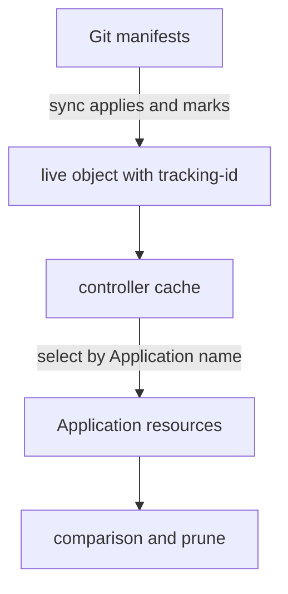

# Resource Tracking

A cluster holds many objects, and only some of them come from a given Application. Argo CD must pick exactly those objects when it compares, prunes and deletes. If it picked too few, drift would go unseen. If it picked too many, it could delete objects that another team owns. This part explains how Argo CD marks the objects of an Application, how it finds them again and what happens when two Applications claim the same object.

## Marking an object

When a sync applies an object, Argo CD adds a marker to it so that it can find the object later. The marker is a tracking identifier. The setting `application.resourceTrackingMethod` in the ConfigMap `argocd-cm` selects how the marker is stored. There are three methods.

- `label` stores the Application name in the label `app.kubernetes.io/instance`. This was the original method. Label values are limited to 63 characters, and other tools also use this label, so it can be overwritten.
- `annotation` stores a full identifier in the annotation `argocd.argoproj.io/tracking-id`. This is the documented default. The identifier has the form `application:group/Kind:namespace/name`, for example `track-alpha:apps/Deployment:starfleet/alpha`.
- `annotation+label` stores the identifier in the annotation and the Application name in the label.

The annotation form carries more information than the label. It names the object itself, not only the Application, so Argo CD can tell that a copy of the object in another namespace is not the tracked object. The documentation gives this case: a controller that copies resources to other namespaces would copy a label too, and the copies would look as if they belonged to the Application. With annotation tracking, a copy whose annotation names another object does not affect the sync status or pruning.

## Finding the objects again

The application controller keeps a cache of live objects in the cluster. For each Application it selects the cached objects whose tracking identifier names that Application, and it compares them with the rendered manifests. An object in the destination namespace without the marker is not part of the Application. Argo CD ignores it, does not compare it and does not prune it, even if it sits in the same namespace.



The diagram shows that the marker written at sync time is what the controller later uses to select the objects of an Application.

Prune depends on this selection. When a manifest leaves Git, Argo CD prunes the live object that is tracked by the Application and no longer rendered. An object that Argo CD does not track is never pruned.

## Two Applications, one object

Nothing in Kubernetes stops two Applications from rendering the same object. The tracking identifier names one Application, so the last sync writes its own identifier over the other. The object then flips between owners, each Application reports the other's changes as drift and with automated sync both keep correcting each other. Argo CD recognizes the situation and adds a warning condition of type `SharedResourceWarning` to the Applications, so a reader can find the conflict in `status.conditions`.

The cure is a design decision. Each object belongs to exactly one Application. If two teams need the same object, one of them owns it and the other only reads it.

## Reading the markers on a live object

Save this as `application-track-alpha.yaml`. The Application syncs the path `workloads/alpha` with automated sync:

<!-- astrona:playground:renew -->

```yaml
apiVersion: argoproj.io/v1alpha1
kind: Application
metadata:
  name: track-alpha
  namespace: argocd
spec:
  project: default
  source:
    repoURL: http://git-source.argocd.svc:8080/repo.git
    targetRevision: main
    path: workloads/alpha
  destination:
    server: https://kubernetes.default.svc
    namespace: starfleet
  syncPolicy:
    automated:
      prune: true
```

Apply it:

```sh
kubectl apply -f application-track-alpha.yaml
kubectl -n argocd wait --for=jsonpath='{.status.sync.status}'=Synced application/track-alpha --timeout=240s
```

Then check the result. Read the tracking annotation of the Deployment and list the objects that the Application owns:

```sh
kubectl -n starfleet get deployment alpha -o jsonpath='{.metadata.annotations.argocd\.argoproj\.io/tracking-id}{"\n"}'
kubectl -n argocd get application track-alpha -o jsonpath='{range .status.resources[*]}{.kind}{" "}{.name}{"\n"}{end}'
```

The first command should print `track-alpha:apps/Deployment:starfleet/alpha`. The second should list the Deployment `alpha` and the Service `alpha`. Now create an object that Argo CD does not track and check that the Application ignores it:

```sh
kubectl -n starfleet create configmap unowned --from-literal=note=hand-made
kubectl -n argocd get application track-alpha -o jsonpath='{.status.sync.status}{"\n"}'
```

The Application should stay `Synced`, and the ConfigMap does not appear in its resource list, because no manifest and no marker links it to the Application.

## What the part showed

Argo CD marks each object it applies with a tracking identifier and selects the objects of an Application by that marker. The default method is the annotation `argocd.argoproj.io/tracking-id`. Objects without the marker are not compared or pruned, and an object rendered by two Applications causes a conflict. The part did not cover what happens to the marked objects when the Application is deleted.

## Common pitfalls

> [!WARNING]
> Changing `application.resourceTrackingMethod` does not re-mark objects at once: the new marker appears at the next sync. Do not let two Applications render the same object. Do not assume that an object in an Application's namespace belongs to it: only the marker says so.
