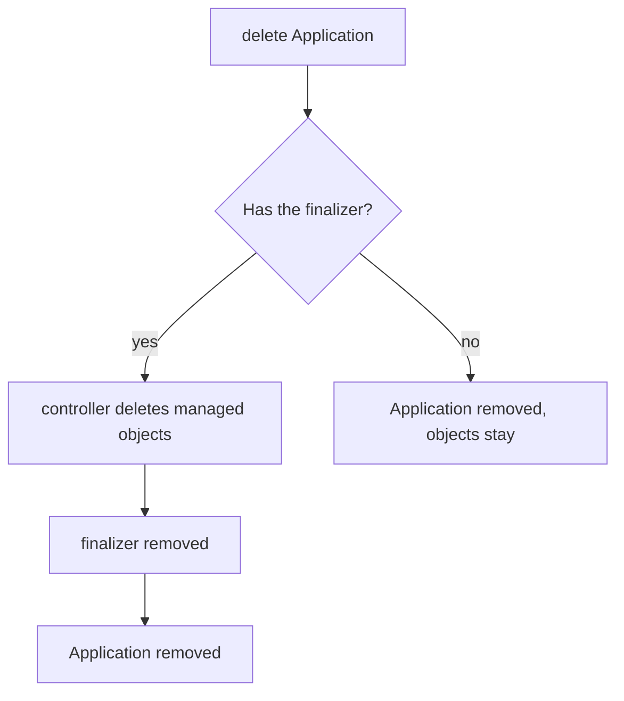

# Finalizers And Application Deletion

Deleting an Application can mean two different things. It can mean "stop managing these objects", or it can mean "remove this whole deployment". Both are valid, and the wrong one is costly. Removing the management object while the workloads keep running leaves objects that nobody owns. Removing the workloads by accident can take down a production service. Argo CD uses a Kubernetes mechanism called a finalizer to let the Application decide. This part explains the finalizer, the two deletion modes and the ways to choose between them.

## What a finalizer is

A finalizer is a string in `metadata.finalizers` of any Kubernetes object. When someone deletes the object, the API server does not remove it at once. It sets `metadata.deletionTimestamp` and keeps the object until a controller has finished its cleanup and removed its string from the list. The object disappears only when the list is empty.

Argo CD uses this for Applications. The application controller sees the deletion timestamp, checks the finalizer and, if it finds the Argo CD finalizer, deletes the managed objects first. Only then does it remove the finalizer and let the Application go.

## The finalizer names

The documented finalizers are:

- `resources-finalizer.argocd.argoproj.io` deletes the managed objects with foreground cascading deletion. The Application stays in the deleting state until Kubernetes has removed the objects and their dependents.
- `resources-finalizer.argocd.argoproj.io/background` deletes the managed objects with background cascading deletion. The Application disappears at once and Kubernetes removes the objects afterwards.

```yaml
metadata:
  finalizers:
  - resources-finalizer.argocd.argoproj.io
```

The manifest comment in the Argo CD documentation says to add this finalizer only if you want cascading deletion.

## Cascading and non-cascading deletion

Without the finalizer, deleting an Application removes only the Application object. The managed objects stay in the cluster, and they still carry their tracking annotation, but nothing manages them anymore. This is non-cascading deletion, also called orphaning. With the finalizer, deletion cascades to the managed objects.



The diagram shows that the finalizer decides whether the managed objects are removed before the Application.

The `argocd` command line client chooses the mode for you. The command `argocd app delete NAME` cascades by default and adds the finalizer. The flag `--cascade=false` orphans the objects. The flag `--propagation-policy` selects `foreground` or `background`. With `kubectl`, you set the finalizer yourself before you delete: patch the Application to hold the finalizer for a cascading delete, or patch `finalizers` to `null` for a non-cascading delete.

## Two exceptions at the object level

Two sync options at the object level change deletion. The annotation `argocd.argoproj.io/sync-options: Delete=false` on an object keeps it when the Application is deleted, even with the finalizer. This protects objects such as a PersistentVolumeClaim (a request for storage whose data you may want to keep). The annotation `argocd.argoproj.io/sync-options: Prune=false` keeps an object from being pruned during a sync. Both exist as Application-level sync options too, and the object-level value overrides the Application value.

## Finalizers on parent and child Applications

An Application can create other Applications. When a parent Application deletes a child Application, the child's own finalizer decides what happens to the child's workloads. A parent that has the finalizer deletes its child Application objects, and each child with the finalizer then deletes its workloads. A parent without it leaves the child Applications in place. The documentation advises adding the finalizer to the child Applications that should clean up and recommends care with the parent, because deleting it can delete a whole fleet.

## Watching both modes

Save this as `application-cascade-demo.yaml`. It has the finalizer and syncs the path `workloads/gamma`:

<!-- astrona:playground:renew -->

```yaml
apiVersion: argoproj.io/v1alpha1
kind: Application
metadata:
  name: cascade-demo
  namespace: argocd
  finalizers:
  - resources-finalizer.argocd.argoproj.io
spec:
  project: default
  source:
    repoURL: http://git-source.argocd.svc:8080/repo.git
    targetRevision: main
    path: workloads/gamma
  destination:
    server: https://kubernetes.default.svc
    namespace: starfleet
  syncPolicy:
    automated:
      prune: true
```

Apply it and wait until the Deployment exists:

```sh
kubectl apply -f application-cascade-demo.yaml
kubectl -n argocd wait --for=jsonpath='{.status.sync.status}'=Synced application/cascade-demo --timeout=240s
```

Then delete the Application and check the result:

```sh
kubectl -n argocd delete application cascade-demo
kubectl -n starfleet get deployment gamma
```

The `delete` command waits until the finalizer has run. The Deployment `gamma` should be gone: `kubectl` answers that it is not found. Now repeat with an Application that has no finalizer. Save this as `application-orphan-demo.yaml`:

```yaml
apiVersion: argoproj.io/v1alpha1
kind: Application
metadata:
  name: orphan-demo
  namespace: argocd
spec:
  project: default
  source:
    repoURL: http://git-source.argocd.svc:8080/repo.git
    targetRevision: main
    path: workloads/beta
  destination:
    server: https://kubernetes.default.svc
    namespace: starfleet
  syncPolicy:
    automated:
      prune: true
```

Apply it, wait, delete it and check the result:

```sh
kubectl apply -f application-orphan-demo.yaml
kubectl -n argocd wait --for=jsonpath='{.status.sync.status}'=Synced application/orphan-demo --timeout=240s
kubectl -n argocd delete application orphan-demo
kubectl -n starfleet get deployment beta -o jsonpath='{.metadata.annotations.argocd\.argoproj\.io/tracking-id}{"\n"}'
```

The Deployment `beta` should still exist and still carry the tracking annotation `orphan-demo:apps/Deployment:starfleet/beta`, although no Application manages it anymore.

## What the part showed

A finalizer on the Application tells the application controller to delete the managed objects before the Application goes. Without it, deletion orphans the objects. The names `resources-finalizer.argocd.argoproj.io` and the `/background` variant choose the propagation policy, and the annotations `Delete=false` and `Prune=false` protect single objects. The part did not cover how one Application creates others.

## Common pitfalls

> [!WARNING]
> An orphaned object keeps running with its tracking annotation, and nothing deletes it later. A finalizer on a parent in an app-of-apps can delete every child and every workload. If an Application hangs in deletion, look at which object cannot be removed before you remove the finalizer by hand.
