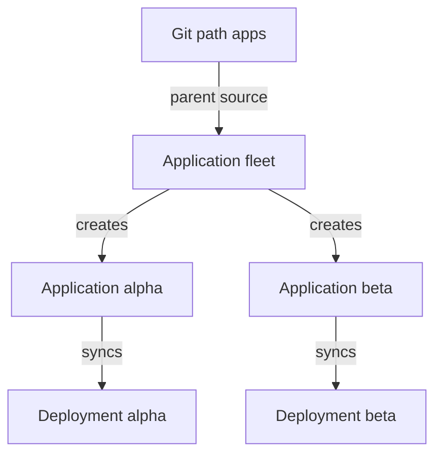

# App Of Apps

A fleet of services needs one Application for each service, and creating each Application by hand does not scale. It also leaves the list of Applications outside Git. Argo CD solves this with an ordinary feature used on itself. An Application is a Kubernetes object, so a Git path can hold Application manifests, and a parent Application can sync that path. This is the app-of-apps pattern. This part explains how it works, which Application does what, how children sync and delete, and which limits to expect.

## How the pattern works

The parent Application has a normal source, a path in Git that holds the YAML of the child Applications, one file for each. Its destination is not a workload namespace. It is the namespace where Applications live, normally `argocd`, because Application objects are namespaced custom resources and the application controller reads them from there.

When the parent syncs, Argo CD applies the child Application manifests like any other objects. The application controller then sees new Applications, and each child works independently. It has its own source, destination and project, and it syncs on its own policy. The parent knows only that the child Application objects exist and match Git. It does not sync the child's workloads.



The diagram shows that the parent creates the child Applications and each child deploys its own workloads.

## The seed example

The seed repository has the path `apps` with two files: `alpha.yaml` and `beta.yaml`. Each is an Application in the project `default` that syncs `workloads/alpha` or `workloads/beta` into `starfleet` with automated prune and `selfHeal`. A parent Application with the source path `apps` and the destination namespace `argocd` creates both children.

## Sync behaviour of parent and children

The documentation states a point that surprises many readers. If the parent has no automated sync, the parent shows `Synced` when its own objects match Git, but the child Applications it created can be `OutOfSync` until someone syncs them. In the seed example the children have automated sync, so they deploy by themselves. With automated sync and prune on the parent, children are created when a manifest is added to Git and deleted when a manifest is removed.

A manifest change in the child path, for example a new `targetRevision`, reaches the cluster in two steps. The parent syncs the changed Application manifest, then the child detects its own source change and syncs. Each step has its own delay.

## Ordering and deletion

Children are applied together unless you order them. Sync waves work in an app-of-apps too: an annotation `argocd.argoproj.io/sync-wave` on a child Application manifest makes the parent apply it in that wave, and the parent waits for the earlier wave to be healthy first. The wait works only if the Application resource has a health assessment, a point the next part explains.

Deletion follows the finalizers. Deleting the parent without the finalizer removes the parent only, and the children stay. With the finalizer on the parent, the controller deletes the child Applications. Each child with its own finalizer then deletes its workloads. A parent that prunes also deletes a child when its manifest leaves Git, with the same finalizer logic. The documentation advises the finalizer on the children to make cleanup complete.

## Projects and security

The parent controls which projects the children use, because the child manifests name their own `project`. Anyone who can change the path of the parent can create an Application in a permissive project. For that reason the documentation treats app-of-apps as an administrator pattern: the parent runs in a project that the administrators control, and writers to its path need the same trust.

## Creating a parent

Save this as `application-fleet.yaml`. The parent has automated sync with prune and the finalizer:

<!-- astrona:playground:renew -->

```yaml
apiVersion: argoproj.io/v1alpha1
kind: Application
metadata:
  name: fleet
  namespace: argocd
  finalizers:
  - resources-finalizer.argocd.argoproj.io
spec:
  project: default
  source:
    repoURL: http://git-source.argocd.svc:8080/repo.git
    targetRevision: main
    path: apps
  destination:
    server: https://kubernetes.default.svc
    namespace: argocd
  syncPolicy:
    automated:
      prune: true
      selfHeal: true
```

Apply it:

```sh
kubectl apply -f application-fleet.yaml
```

Then check the result. List the Applications and the tracking annotation of a child:

```sh
kubectl -n argocd get applications -o custom-columns=NAME:.metadata.name,SYNC:.status.sync.status,HEALTH:.status.health.status
kubectl -n argocd get application alpha -o jsonpath='{.metadata.annotations.argocd\.argoproj\.io/tracking-id}{"\n"}'
```

After a short time the list should show `fleet`, `alpha` and `beta`, and the children should become `Synced` and `Healthy` once their Deployments are ready. The annotation should read `fleet:argoproj.io/Application:argocd/alpha`: the parent tracks the child Application object as one of its resources, just as an Application tracks a Deployment.

## What the part showed

A parent Application syncs a Git path of Application manifests into the namespace of the Applications. Each child then syncs its own workloads. The parent tracks the child objects, so pruning, finalizers and the project of the child manifests all follow from the parent's source. The open question is how health flows between the levels.

## Common pitfalls

> [!WARNING]
> The destination of a parent is the namespace of the Applications, not the workload namespace. A parent without automated sync leaves children `OutOfSync`. A finalizer on the parent can delete the whole fleet, and a writer to the parent's path can pick the project of every child.
