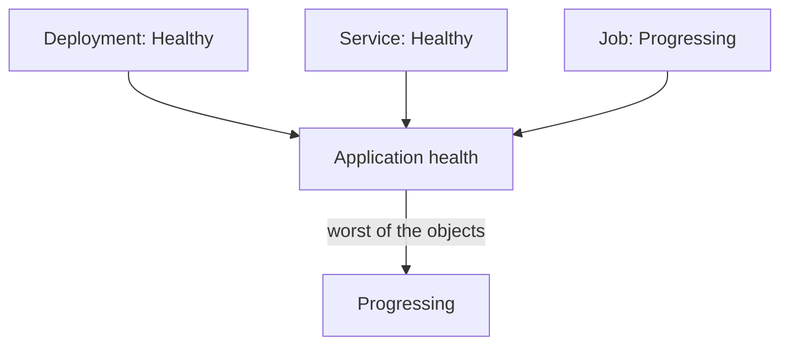

# Application Health

Sync status answers one question: does the cluster match Git? It does not answer whether the application works. A Deployment can match Git exactly and still have no running pod. Argo CD therefore has a second status, health. This part explains the health values, how Argo CD assesses each object, how it combines them into the health of an Application and why a parent Application does not show the health of its children by default.

## The health values

Each object and each Application has one health status. These are the values.

- `Healthy`: the object works as intended.
- `Progressing`: the object is not healthy yet, but it is making progress and may become healthy soon.
- `Degraded`: the object has failed or cannot make progress.
- `Suspended`: the object is paused and waits for an external event to resume. A CronJob that is suspended is an example.
- `Missing`: the object is in Git but not in the cluster.
- `Unknown`: Argo CD cannot assess the health.

The sync status and the health are independent. An Application can be `Synced` and `Degraded`, or `OutOfSync` and `Healthy`. Reading both is the minimum for a diagnosis.

## How an object is assessed

Argo CD has built-in health checks for common kinds. They read the `status` of the live object.

- A Deployment is healthy when the observed generation equals the desired generation, and the rollout has completed with all replicas updated and available. A Deployment that has not finished is `Progressing`.
- A Service is healthy by default, except for the type `LoadBalancer`, which needs a non-empty `status.loadBalancer.ingress`.
- An Ingress is healthy when `status.loadBalancer.ingress` has at least one address or host name.
- A PersistentVolumeClaim is healthy when its `status.phase` is `Bound`.

For a kind without a built-in check, such as a custom resource, Argo CD cannot assess the health. A custom check is a Lua script (a small script language that Argo CD embeds) stored in `argocd-cm` under the key `resource.customizations.health.GROUP_KIND`, for example `resource.customizations.health.argoproj.io_Application`. The script reads the object's status and returns a status and a message.

## From objects to the Application

The health of an Application is the worst health among its immediate resources. The documented priority from best to worst is `Healthy`, `Suspended`, `Progressing`, `Missing`, `Degraded`, `Unknown`. One `Degraded` object makes the whole Application `Degraded`. The message of the worst object appears in `status.health.message` of the Application.



The diagram shows that the Application takes the worst status of its objects, here `Progressing` from the Job.

## When a failure becomes Degraded

Health follows the status that Kubernetes publishes, and Kubernetes can be slow to publish a failure. A Deployment whose image does not exist creates pods in the state `ImagePullBackOff`. The Deployment itself keeps `Progressing`, because it is still trying. The condition `ProgressDeadlineExceeded` appears only after `spec.progressDeadlineSeconds`, which defaults to 600 seconds. Only then does Argo CD report `Degraded`. For about ten minutes the Application shows `Progressing`, even though the problem is clear from the pods. When a health state surprises you, read the pods and the events of the failing object.

A sync can fail without any health problem. A manifest of a kind the cluster does not know fails the sync operation, and the Application is `OutOfSync` with a failed operation. The health describes the objects that exist.

## Health of the Application resource itself

Argo CD removed the built-in health assessment of the `argoproj.io/Application` kind in version 1.8. A parent Application therefore has no health information about its children unless you add a custom check. The parent can be `Healthy` while a child is `Degraded`, because the parent's objects are the Application manifests, and Argo CD does not assess them. Sync waves between children also wait for no health until you add the check, which affects the ordering described for app-of-apps. A custom Lua check on `argoproj.io_Application` that copies the child's `status.health` fixes both points.

## Reading health on a live Application

Save this as `application-bad-image.yaml`. It syncs the path `broken/bad-image`, whose image does not exist:

<!-- astrona:playground:renew -->

```yaml
apiVersion: argoproj.io/v1alpha1
kind: Application
metadata:
  name: bad-image
  namespace: argocd
spec:
  project: default
  source:
    repoURL: http://git-source.argocd.svc:8080/repo.git
    targetRevision: main
    path: broken/bad-image
  destination:
    server: https://kubernetes.default.svc
    namespace: starfleet
  syncPolicy:
    automated: {}
```

Apply it:

```sh
kubectl apply -f application-bad-image.yaml
kubectl -n argocd wait --for=jsonpath='{.status.sync.status}'=Synced application/bad-image --timeout=240s
```

Then check the result. Read the Application health and the pod state side by side:

```sh
kubectl -n argocd get application bad-image -o jsonpath='{.status.sync.status}{" "}{.status.health.status}{"\n"}'
kubectl -n starfleet get pods -l app=bad-image
```

The Application should be `Synced` and `Progressing`, and the pod should show an image pull problem such as `ErrImagePull` or `ImagePullBackOff`. After the progress deadline of ten minutes the health changes to `Degraded`. Sync and health tell different stories: the cluster matches Git, and the application does not work.

## What the part showed

Health has six values and is independent of sync status. Argo CD assesses objects with built-in checks and custom Lua checks, and an Application takes the worst health of its objects. Health follows Kubernetes status, so a failure can stay `Progressing` until the progress deadline passes. The Application kind has no built-in check, so a parent does not show the health of its children.

## Common pitfalls

> [!WARNING]
> `Synced` does not mean the application works: read `status.health.status` too. A `Progressing` Application with a pod in `ImagePullBackOff` is a failure that has not been reported yet. A parent in an app-of-apps can be `Healthy` while a child is `Degraded` unless a custom health check exists for the Application kind.
