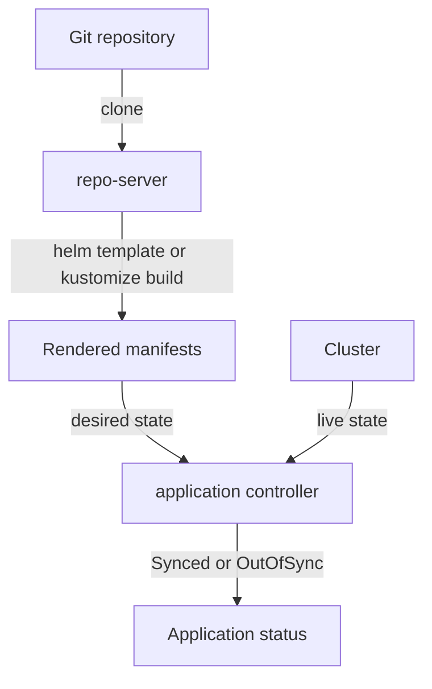

# Helm Charts As Argo CD Rendering Input

A Git directory can hold plain manifests, a Helm chart or a Kustomize configuration. Argo CD must turn each of them into the list of Kubernetes objects it compares with the cluster. This chapter explains who does that work, how Argo CD decides which tool to run, and what it means that Argo CD uses Helm only to render.

## Rendering and reconciling are two jobs

Argo CD splits the work between two components. The repository server (`argocd-repo-server`) clones the Git repository, runs the rendering tool and returns a list of manifests. A manifest is the YAML description of one Kubernetes object. The application controller (`argocd-application-controller`) asks the repository server for that list, reads the live objects from the cluster, compares the two and applies the difference when a sync runs.



The diagram shows that the rendering tool runs in the repository server and that the controller never sees the chart or the overlay, only the rendered manifests. A rendering error therefore appears on the Application as a comparison error, before any object is touched in the cluster.

## How Argo CD chooses the tool

Argo CD looks at the directory named by `spec.source.path`. If the Application sets a tool block under `spec.source`, such as `helm` or `kustomize`, Argo CD uses that tool. If it sets none, Argo CD detects the tool from the files in the directory:

- A file named `Chart.yaml` selects Helm.
- A file named `kustomization.yaml`, `kustomization.yml` or `Kustomization` selects Kustomize.
- Neither file selects the plain directory tool, which reads every YAML file in the directory.

The result is visible on the Application as `status.sourceType`, with the value `Helm`, `Kustomize` or `Directory`. In the seed repository the path `chart` has a `Chart.yaml`, so it renders with Helm. The path `plain` has a `kustomization.yaml` next to its manifest, so it renders with Kustomize even though the folder looks like plain YAML. Detection looks only at that one directory, never at its parents.

## What a Helm chart is

Helm is a package manager for Kubernetes. A chart is a directory with a `Chart.yaml` file that names the chart, a `templates` directory with manifests that contain placeholders, and a `values.yaml` file with the default value for each placeholder. Helm combines the templates with the values and produces manifests. That step is called rendering. The seed chart renders a Deployment and a Service, both named `git-probe`:

```yaml
spec:
  replicas: {{ .Values.replicas }}
  template:
    spec:
      containers:
      - name: git-probe
        image: "{{ .Values.image.repository }}:{{ .Values.image.tag }}"
```

The default values in the chart set `replicas: 2` and the image `docker.io/library/python` with the tag `3.13-alpine`. A second file in the chart, `values-prod.yaml`, holds only `replicas: 3`. Helm uses it only when someone passes it as an extra values file. Rendering the chart with the defaults gives a Deployment with two replicas and the image `docker.io/library/python:3.13-alpine`.

## Argo CD renders with helm template

Helm normally installs a chart with `helm install`. That command renders the manifests, applies them and stores a release record, which is a Kubernetes Secret that holds the chart and values. Argo CD does none of this. The repository server runs `helm template`, which prints the manifests and stops. The application controller then applies and tracks the objects, and Argo CD, not Helm, owns them. No release Secret is created, and `helm list` shows nothing for an Application.

Argo CD gives `helm template` three inputs besides the chart. The release name defaults to the name of the Application. The namespace is the destination namespace of the Application. The values come from the Application and from the chart. The seed chart does not use the release name, so its object names stay `git-probe` whatever the Application is called.

## A first Application for the chart

An Application that points at the chart needs no tool block, because the `Chart.yaml` file already selects Helm:

```yaml
apiVersion: argoproj.io/v1alpha1
kind: Application
metadata:
  name: mission
  namespace: argocd
spec:
  project: default
  source:
    repoURL: http://git-source.argocd.svc:8080/repo.git
    targetRevision: main
    path: chart
  destination:
    server: https://kubernetes.default.svc
    namespace: starfleet
  syncPolicy:
    automated:
      prune: true
```

When the controller reconciles this Application, the repository server resolves `main` to a commit, which Argo CD stores in `status.sync.revision`. It renders the chart, and the controller creates the Deployment and the Service in `starfleet`. The field `status.summary.images` then lists the image of the Deployment, which is the quickest proof of what the render produced.

## Rendering does not mean healthy

A successful render means only that the tool produced manifests. The cluster can still reject an object, an image can be missing, and a pod can crash. Argo CD reports these cases in different fields. `status.sync.status` says whether the rendered manifests match the cluster. `status.health.status` says whether the objects work. An Application can be `Synced` and `Degraded` at the same time, and only the second field tells you that the pods failed.

## Where the namespace comes from

The destination namespace is the default namespace for objects that do not name one. It is not a rewrite. The seed chart writes `namespace: starfleet` into each template. Because the manifests name a namespace themselves, Argo CD creates the objects there, whatever `destination.namespace` says. A chart that leaves the namespace out of its templates takes the destination namespace instead.

## What the chapter showed

Argo CD renders Helm charts with `helm template` inside the repository server and gives the manifests to the application controller, which compares and applies them. The tool comes from an explicit block or from the files in the directory, and `status.sourceType` records the choice. Helm contributes only the rendering, not an installed release. The open question is how the same model applies to a tool that works without templates.

## Common pitfalls

> [!WARNING]
> Do not expect `helm list`, `helm upgrade` or `helm rollback` to work on an Argo CD Application: no Helm release exists. Do not assume that a folder with plain looking YAML is a plain directory: one `kustomization.yaml` makes Argo CD run Kustomize on it. A successful render says nothing about health.
