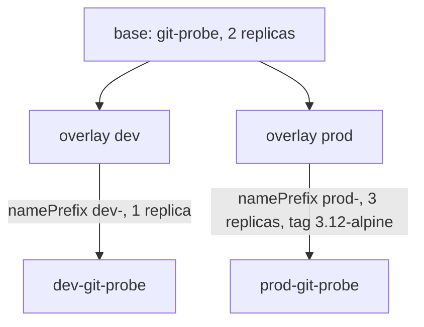

# Kustomize Bases And Overlays As Argo CD Rendering Input

Helm solves the difference between environments with placeholders and values. Kustomize solves it without placeholders: it keeps ordinary manifests and describes the changes for each environment in a separate directory. This chapter explains how Kustomize builds its output, which directory Argo CD builds, and why the names, labels and replica counts in the cluster can differ from the files in the base.

## A base and its overlays

Kustomize is a tool that builds manifests from a `kustomization.yaml` file. That file lists resources, which are manifest files or other directories, and transformations that change them. A base is a directory with complete manifests and a `kustomization.yaml` that lists them. An overlay is a directory whose `kustomization.yaml` lists a base as a resource and adds its own changes.

The seed repository has one base and two overlays:

```text
kustomize/base/app.yaml
kustomize/base/kustomization.yaml
kustomize/overlays/dev/kustomization.yaml
kustomize/overlays/prod/kustomization.yaml
```

The base holds a Deployment and a Service named `git-probe` in the namespace `starfleet`. The Deployment has two replicas and the image `docker.io/library/python:3.13-alpine`. The base can be built alone, but a team normally deploys an overlay.

## What the overlays change

The `dev` overlay lists `../../base` as its resource and adds three transformations:

```yaml
resources:
- ../../base
namePrefix: dev-
labels:
- pairs:
    environment: dev
replicas:
- name: git-probe
  count: 1
```

The field `namePrefix` puts `dev-` in front of the name of every resource, so the Deployment becomes `dev-git-probe` and the Service becomes `dev-git-probe`. Kustomize also rewrites the references between the resources that it knows about. The field `labels` adds the label `environment: dev` to every resource. The field `replicas` sets the replica count of the Deployment named `git-probe` to one. The name in `replicas` is the name in the base, before the prefix.

The `prod` overlay uses the prefix `prod-`, the label `environment: prod` and three replicas. It also has an `images` entry that keeps the image name `docker.io/library/python` and sets `newTag: 3.12-alpine`, so the production Deployment runs `docker.io/library/python:3.12-alpine`.

## Argo CD builds one directory

Kustomize builds the directory that you give it, and Argo CD gives it `spec.source.path`. To deploy the production overlay, the Application sets `path: kustomize/overlays/prod`. Argo CD detects the file `kustomization.yaml` in that directory and runs `kustomize build` there. Kustomize follows the `resources` entry to the base and applies the transformations from the overlay on the result.

```yaml
spec:
  source:
    repoURL: http://git-source.argocd.svc:8080/repo.git
    targetRevision: main
    path: kustomize/overlays/prod
  destination:
    server: https://kubernetes.default.svc
    namespace: starfleet
```

An Application that points at the base alone would deploy `git-probe` with two replicas. An Application that points at the `prod` overlay deploys `prod-git-probe` with three replicas and the older image tag. The two Applications can run side by side, because their object names do not collide. The path decides everything, which is why a wrong path is the most common cause of a wrong deployment.



The diagram shows that both overlays start from the same base and that each one produces its own set of objects.

## The namespace stays as written

The base writes `namespace: starfleet` into each manifest, and the overlays do not change it. The objects therefore live in `starfleet`, and the destination namespace of the Application only repeats it. If an overlay should place the objects in another namespace, the `kustomization.yaml` needs a `namespace` field. A namespace in the Application destination does not move objects whose manifests already name one.

## Kustomize needs no cluster

Kustomize builds from the files in the directory and in the bases that it references. It does not read the cluster. A remote base, written as a Git URL in `resources`, is fetched at build time. If that URL points at a moving target such as a branch, the output can change while the Application revision stays the same. Argo CD users avoid this by pinning remote bases to a tag or a commit.

## What the objects carry

Kustomize adds the labels it is told to add and nothing else. Argo CD marks every object it manages with its own tracking metadata so that it can tell them apart from other objects. The `environment` label is yours. Both are visible in the live Deployment, and the Application status lists them together with the revision it built from.

The field `status.sourceType` of such an Application is `Kustomize`, and `status.summary.images` lists the image after the overlay changed the tag. Reading these fields is how you prove that the overlay, and not the base, reached the cluster. For the `prod` overlay the list holds `docker.io/library/python:3.12-alpine`, not the `3.13-alpine` of the base.

## What the chapter showed

A Kustomize overlay is a directory that refers to a base and changes names, labels, replicas or images. Argo CD builds the directory named by `path` with `kustomize build`, compares the output with the cluster and applies it. Changing the path changes the whole result, and the object names include the prefix. What is still open is how to see the rendered result before and after a sync, and how to override the result from the Application itself.

## Common pitfalls

> [!WARNING]
> Pointing the Application at the base instead of an overlay deploys the unchanged base. A name prefix changes every object name, so a command that asks for `git-probe` finds nothing when the object is called `prod-git-probe`. A namespace in the Application destination does not move objects whose manifests name a namespace.
