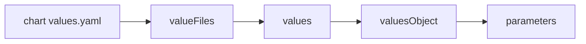

# Helm Value Sources And Precedence In An Application

One chart serves many environments only when the environments can change its values. An Application can set values in four places, and a mistake in the order gives a Deployment that looks right in Git and wrong in the cluster. This chapter lists the four sources, states which one wins, and shows how to check the final value without guessing.

## What a value is

Helm is the package manager that renders a chart. A value is one setting that the chart templates read, such as the replica count. A chart ships its defaults in the file `values.yaml`. Helm builds the final set of values by starting with those defaults and then merging overrides on top, key by key. A key that no override sets keeps its default. A key that several overrides set takes the value of the last one that Helm reads.

The seed chart reads two values: `replicas` and the nested key `image.tag`. The nested key is written with a dot in the name of a parameter and as a nested map in a YAML file.

## The four override sources

An Application sets Helm overrides under `spec.source.helm`. Each source has its own field:

- `valueFiles` is a list of values files that sit in the Git repository, relative to the chart directory. Argo CD passes each file to Helm with `--values`, in the order of the list. When two files set the same key, the file that comes later in the list wins.
- `values` is a string that holds the contents of a values file. It is kept for older Applications.
- `valuesObject` holds the same content as structured YAML, so the Application can show it as normal fields. It takes precedence over `values`, and the documentation recommends it.
- `parameters` is a list of single keys, each with a `name` and a `value`. Argo CD passes them to Helm as `--set`. They are the strongest source.

The chart defaults in `values.yaml` come first, and the sources then apply in this order, from weakest to strongest: the chart `values.yaml`, `valueFiles`, `values`, `valuesObject`, `parameters`.



The diagram shows the order in which Helm applies the sources, so the last box wins whenever two boxes set the same key.

## One example with all layers

The next Application layers three sources on the seed chart. The file, the object and the parameter all set `replicas`, and only the object sets the image tag:

```yaml
spec:
  source:
    repoURL: http://git-source.argocd.svc:8080/repo.git
    targetRevision: main
    path: chart
    helm:
      valueFiles:
      - values-prod.yaml
      valuesObject:
        replicas: 2
        image:
          tag: 3.12-alpine
      parameters:
      - name: replicas
        value: "4"
```

The chart default is `replicas: 2`. The file `values-prod.yaml` sets it to 3. The `valuesObject` sets it to 2 again and sets the image tag to `3.12-alpine`. The parameter sets it to 4. The final value is 4, because `parameters` come last. The image tag comes from the `valuesObject`, because no stronger source sets it, so the Deployment runs `docker.io/library/python:3.12-alpine`. Running the same layering with the Helm command line gives a Deployment with four replicas and that image, which confirms the order.

## Why parameters are quoted

A parameter value is always a string in the Application YAML, so `value: "4"` carries the text `4`. Helm reads text for `--set` and converts it, so the chart sees the number 4 and `replicas: {{ .Values.replicas }}` renders `replicas: 4`. When a chart needs the text itself, such as a version `1.10` that must not become a number, set `forceString: true` on the parameter, and Argo CD tells Helm to keep it as a string.

A parameter name uses dots for nesting. The name `image.tag` sets the key `tag` inside the map `image`. A typo creates a new unused key and changes nothing, because Helm does not check names against the chart unless the chart ships a values schema.

## Paths of values files

Argo CD resolves each entry of `valueFiles` relative to the chart directory, so `values-prod.yaml` means `chart/values-prod.yaml`. A path that starts with `/` is relative to the root of the repository. Argo CD also accepts glob patterns, which it expands in alphabetical order. A file that does not exist is an error: the Application shows a comparison error and renders nothing. Setting `ignoreMissingValueFiles: true` turns that error into a skip, which is useful for optional per-environment files and dangerous when a typo hides a file that should be there.

## Choosing a source

Each source fits a different kind of change. A values file in the chart directory suits a stable set of settings for one environment, because a reviewer reads it in Git like any other file. The `valuesObject` suits a few settings that belong to the Application and not to the chart, such as a replica count that one team sets for one cluster. A parameter suits one value that a person or a pipeline changes often, because `argocd app set` can change a parameter without editing a file.

The cost of each source is where the knowledge lives. A value in a file lives in the chart repository, and a value in `valuesObject` or `parameters` lives in the Application object. A person who reads only the chart then misses part of the configuration. Keep the number of layers small, and write down in the Application which layer owns which key.

Values files also have a limit that matters for large teams. A file listed in `valueFiles` must come from the same repository as the chart unless the Application uses several sources, which Argo CD supports from version 2.6. The seed repository is a single source, so every file in these examples sits in the chart directory.

## Seeing the effective values

The web interface shows only the parameters of an Application, not the merged result. The merged result is visible in the rendered manifests. The command `argocd app manifests NAME` prints what the repository server rendered, and the status field `status.summary.images` lists the images. When a value looks wrong, read the rendered Deployment instead of the sources, because the Deployment is the only place where all layers have already been merged.

## What the chapter showed

An Application overrides chart values with `valueFiles`, `values`, `valuesObject` and `parameters`, and the last of those wins for each key. Files apply in list order, objects and parameters are single layers, and a missing file stops the render unless the Application ignores it. The remaining questions are the settings that shape the Helm run beyond the values: the release name, the namespace, custom resource definitions and hooks.

## Common pitfalls

> [!WARNING]
> A parameter beats a `valuesObject`, which beats a file, so an old parameter silently hides a new value in the file. Parameter names with a typo create unused keys and no error. A missing values file fails the render unless `ignoreMissingValueFiles` is true, and that setting also hides typos.
