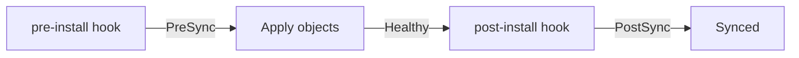

# Release Names, Namespaces, Hooks And Deterministic Rendering

Values are only part of what Helm receives. Argo CD also passes a release name and a namespace, decides whether to install custom resource definitions, and translates Helm hooks into its own sync hooks. A chart can also render different output on every run, which makes an Application look permanently out of date. This chapter covers each of these settings and the failure it causes when it is wrong.

## The release name

Helm templates can read the release name as `.Release.Name`. Many charts use it to name the objects they create, so two releases of the same chart can live in one namespace. Argo CD sets the release name to the name of the Application. The Application `probe-helm` renders the chart as the release `probe-helm`.

The field `spec.source.helm.releaseName` overrides that default. Set it when the objects must keep the name that an older installation gave them, or when the Application name is longer than the chart allows. A new release name changes every object name that the chart builds from it, and Argo CD sees those as new objects: it creates them and, with pruning on, deletes the old ones.

The seed chart writes the fixed name `git-probe` into its templates and never reads `.Release.Name`. Its object names therefore do not change with the Application name or with `releaseName`. A chart that does read the release name in its label selectors needs extra care. The documentation warns that overriding the release name can break selectors that use the label `app.kubernetes.io/instance`, because Argo CD sets that label to the Application name by default.

## The namespace

Argo CD passes the destination namespace of the Application to `helm template` as the namespace of the release. A chart that reads `.Release.Namespace` in its templates, or that leaves the namespace out of its manifests, puts its objects there. The field `spec.source.helm.namespace` templates with another namespace when the two must differ.

A manifest that writes its own namespace keeps it. The seed chart writes `namespace: starfleet` in every template, so an Application with the destination namespace `outpost` still creates its objects in `starfleet`. Argo CD does not rewrite namespaces that the manifests state. The AppProject must allow the namespace that the manifests name, or the sync fails. This is a common reason for objects that appear in an unexpected namespace.

## Custom resource definitions

A chart can ship custom resource definitions, which are objects that teach the Kubernetes API a new resource kind, in a directory named `crds`. Helm installs them before the templates. Argo CD does the same by default. When the cluster already has the definitions, set `skipCrds: true` so that Argo CD does not try to manage them. Charts that create custom resources of their own kind in the same sync can fail on the first attempt, because the definition does not exist yet. A retry, or a sync wave that orders the definition first, fixes the order.

## Helm hooks become Argo CD hooks

A Helm hook is a manifest with the annotation `helm.sh/hook` that runs at a stage of an install or upgrade, such as a database migration Job. Argo CD does not run Helm installs, so it maps the hook annotations to its own sync hooks:

| Helm annotation | Argo CD hook |
| --- | --- |
| `pre-install`, `pre-upgrade` | `PreSync` |
| `post-install`, `post-upgrade` | `PostSync` |
| `pre-delete` | `PreDelete` |
| `post-delete` | `PostDelete` |
| `helm.sh/hook-weight` | `argocd.argoproj.io/sync-wave` |

Argo CD cannot tell an install from an upgrade, so a hook declared for both runs on every sync. Annotations that Argo CD does not support are ignored, for example `pre-rollback`, `test-success` and `hook-delete-timeout`. If a chart already carries Argo CD hook annotations on any manifest, Argo CD ignores all Helm hooks of that chart. A migration Job that was written for one install can therefore run on every sync until its annotations change.

## All release settings in one block

The settings in this chapter live next to the values under `spec.source.helm`. The block below sets a release name, keeps the custom resource definitions out of the sync and skips schema validation:

```yaml
spec:
  source:
    path: chart
    helm:
      releaseName: probe
      skipCrds: true
      skipSchemaValidation: true
```

Each field has a command line form in `argocd app set`: `--release-name`, `--helm-skip-crds` and `--helm-skip-schema-validation`. The command changes the Application object in the cluster, not the file in Git, so a later sync from a declarative file can overwrite it. Teams that keep Applications in Git change the file instead.

## Settings that describe the cluster to Helm

Charts can branch on the Kubernetes version or on the API versions that exist, for example to choose between two versions of an Ingress API. During a real install Helm asks the cluster. During `helm template` it has no cluster, so Argo CD passes the details in. By default Argo CD uses the version and the API versions of the target cluster. The fields `kubeVersion` and `apiVersions` under `spec.source.helm` override them, which lets you render for a cluster that you do not run yet.

The field `skipSchemaValidation` matters for charts that ship a `values.schema.json` file. Helm checks the final values against that schema and stops the render on a mismatch. Skipping the check hides a bad value, so use it only when the schema is wrong and cannot be fixed.

## Rendering must give the same output twice

Argo CD renders the chart again at every refresh and compares the result with the cluster. A template that calls a random function, for example `randAlphaNum` to generate a password, produces a different value on each render. The rendered manifest then never equals the live object, and the Application stays `OutOfSync` although nothing changed in Git.

The fix is to make the value stable. A parameter such as `password` set in the Application replaces the random call in the template, and the render becomes identical every time. The same rule applies to templates that read the current time. Pinning inputs matters as well: a chart that depends on a mutable dependency, such as a branch, can change output without a new commit in the Application revision.

## Order of hooks in a sync

Because the hooks become Argo CD hooks, they follow the sync phases. The `PreSync` hooks run first and must succeed. Then Argo CD applies the normal objects, and the `PostSync` hooks run after the objects are healthy.



The diagram shows that a failed `pre-install` hook stops the sync before any normal object changes, which protects the cluster from a migration that did not finish.

## Rendering does not read the cluster

Helm functions such as `lookup` read live objects when Helm installs a chart. Argo CD renders with `helm template` in the repository server, which has no cluster connection for this purpose, so such a function returns an empty result. A chart that depends on `lookup` renders differently in Argo CD than in a manual install. Check this before moving a chart that was installed by hand.

## What the chapter showed

The release name defaults to the Application name and can change object names. The destination namespace fills gaps but does not override namespaces written in manifests. Custom resource definitions install by default, Helm hooks map to sync hooks, and random or cluster-dependent templates make the render unstable. What remains is to see these effects in a running cluster.

## Common pitfalls

> [!WARNING]
> Do not rely on the destination namespace to move objects: a manifest that names a namespace keeps it. Do not change `releaseName` on a live Application without checking which object names it changes, because with pruning on Argo CD deletes the old objects. A chart with random functions stays `OutOfSync` until the random value is replaced by a stable parameter.
