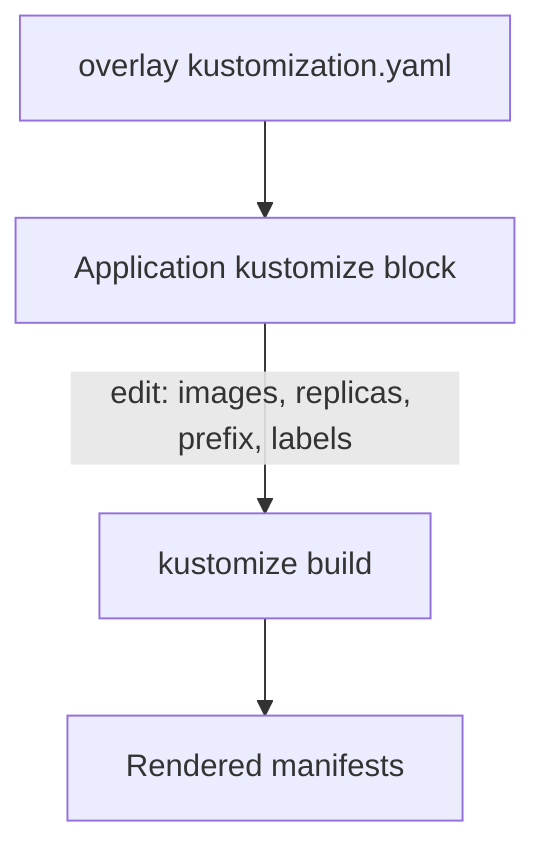

# Kustomize Overrides In The Application

An overlay in Git is the right place for a difference that every cluster shares. It is the wrong place for a difference that only one Application needs, because a new overlay for one image tag multiplies directories. Argo CD solves this with the block `spec.source.kustomize`, which changes the build result without a commit. This chapter lists what the block can change, shows how the changes combine with an overlay, and explains the settings that make labels and patches safe.

## Where the overrides apply

Argo CD builds the directory in `spec.source.path`. Before it runs `kustomize build`, it applies the settings of `spec.source.kustomize` to the kustomization in that directory, in effect the same as running `kustomize edit` commands there. The overlay in Git is not changed. Only the build input of this one Application changes, and the same overlay deployed by another Application stays as it is.

The block supports these fields:

- `namePrefix` and `nameSuffix` add text to the front and the end of every resource name.
- `images` is a list of image overrides in the form `name:tag`, or `old=new:tag` to replace the image name too.
- `replicas` is a list of `name` and `count` entries that set the replica count of a Deployment or StatefulSet.
- `commonLabels` and `commonAnnotations` are maps that Kustomize adds to every resource.
- `namespace` sets the namespace of every resource, which differs from `destination.namespace` because it rewrites the manifests.
- `patches` is a list of inline patches, in the same format as the `patches` field of a `kustomization.yaml`.
- `components` lists Kustomize components, which are reusable pieces that an overlay can add.
- `version` selects a Kustomize version that the administrator configured.

## An override beats the overlay

The overlay `prod` already sets a name prefix, three replicas and an image tag. When the Application sets the same keys, the Application value replaces the overlay value. The Application below keeps the production overlay and changes two things:

```yaml
spec:
  source:
    repoURL: http://git-source.argocd.svc:8080/repo.git
    targetRevision: main
    path: kustomize/overlays/prod
    kustomize:
      images:
      - docker.io/library/python:3.13-alpine
      replicas:
      - name: git-probe
        count: 2
```

The overlay would give three replicas and the tag `3.12-alpine`. With these overrides the build gives two replicas and the tag `3.13-alpine`, and the other results of the overlay, such as the prefix `prod-` and the label `environment: prod`, stay. Building the same overlay by hand with `kustomize edit set image` and `kustomize edit set replicas` produces exactly this result, which confirms the order. The name in `replicas` is the name in the base, `git-probe`, not the prefixed name.

## Annotations and labels

The field `commonAnnotations` adds the same annotations to every resource and to the pod template of every workload. The annotation `fleet.starfleet/owner: operations` therefore appears on the Deployment, on the Service and on the pods. This is the usual way to record an owner or a ticket number in every object without editing the base.

The field `commonLabels` works the same way, with one more effect. Kustomize adds a common label to the selectors of Deployments and Services too, unless the Application sets `labelWithoutSelector: true`. A selector of an existing Deployment cannot change, because Kubernetes treats `spec.selector` as immutable. Adding a common label to a live Deployment can therefore make the sync fail. Set `labelWithoutSelector: true` when the label is only descriptive.

If a label key already exists in the kustomization, Argo CD refuses to add it again and generation fails. Set `forceCommonLabels: true` to replace the existing entry, and `forceCommonAnnotations: true` for annotations. Use the force flags on purpose, because they overwrite a value that the overlay author chose.



The diagram shows that the Application settings change the kustomization before the build, so the build output already holds the override and nothing is patched afterwards.

## Inline patches

The field `patches` takes the same entries as a `kustomization.yaml`: a `patch` string, and optionally a `target` that selects the resources. The string can be a strategic merge patch, which looks like a partial manifest, or a JSON patch.

```yaml
kustomize:
  patches:
  - patch: |-
      apiVersion: apps/v1
      kind: Deployment
      metadata:
        name: git-probe
        namespace: starfleet
      spec:
        template:
          spec:
            containers:
            - name: git-probe
              resources:
                requests:
                  cpu: 25m
```

The patch identifies its resource by kind, name and namespace as they are in the base. It names `git-probe` and not `prod-git-probe`, and it must name `starfleet`, because the base writes that namespace. A patch without the namespace finds no resource and the build fails with an error that names the missing target. When the patch matches, the Deployment gets the CPU request, and the container list merges by name, so the rest of the container stays.

## Choosing between an overlay and an override

An overlay change goes through review in Git and applies to every Application that uses it. An Application override applies to one Application only and lives in the cluster object. Use the overlay for a permanent environment difference and the override for a difference that belongs to one deployment, such as a temporary image pin during an incident. Overrides left in place for months become hidden configuration, so write down why each one exists.

## What the chapter showed

The block `spec.source.kustomize` changes names, images, replicas, labels, annotations and patches before the build, and its values replace the same keys in the overlay. Common labels reach selectors by default, which makes them risky on live Deployments, and an inline patch must name its target as the base does. The open question is how to see the final result and what to do when the build fails.

## Common pitfalls

> [!WARNING]
> Name the base resource in `replicas` and in patches, not the prefixed name. Add `namespace` to a patch when the base sets one. A common label changes selectors unless `labelWithoutSelector` is true, and a Deployment selector cannot change after creation.
