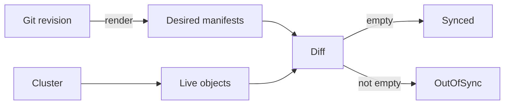

# Inspecting Rendered Manifests And Diagnosing Render Failures

A Helm chart or a Kustomize overlay hides the final manifests behind layers of settings. When a deployment looks wrong, reading the source files rarely answers why. The answer is in the rendered output, and Argo CD can show it. This chapter explains how to read that output, how a render failure shows up on an Application, and how to keep rendering reproducible and free of exposed values.

## Three views of the same object

For each resource, three versions can differ. The desired manifest is what the repository server rendered from Git. The live object is what the cluster holds now. The diff is the difference between them, which the controller turns into the sync status `Synced` or `OutOfSync`.

The command `argocd app manifests NAME` prints the rendered manifests. By default it prints the desired state from Git. With `--source live` it prints the live objects instead, and with `--revision` it renders a chosen revision. The command `argocd app diff NAME` prints the difference between live and desired. Both commands work in core mode with the flag `--core`.



The diagram shows that the sync status is the result of one comparison between the rendered manifests and the live objects. When you doubt a value, compare the two views of the one resource.

## The Application status as evidence

The status of the Application records what the last render produced. The field `status.sync.revision` holds the commit that Argo CD rendered. The field `status.sourceType` names the tool, and `status.summary.images` lists the images in the rendered workloads. The field `status.sync.comparedTo` records the source and destination that the comparison used. These fields answer three questions quickly: which commit, which tool and which image.

A common surprise is a push to Git that does not show up. Argo CD may still hold the previous render in its cache. A normal refresh checks Git for a new commit and compares again. A hard refresh also clears the cached manifests and renders again from scratch. Annotate the Application with `argocd.argoproj.io/refresh: hard` to request it. Use it when the commit is the same but an input that the render depends on changed.

## Refresh types and sync status values

Two kinds of refresh exist, and they answer different questions.

- A normal refresh fetches the latest commit of the revision, renders when the commit changed or the Application spec changed, and compares the result with the cluster.
- A hard refresh does the same and also drops the cached manifests, so the repository server renders again from the repository content.

The annotation that requests a refresh looks like this on the Application. Argo CD removes the annotation after it has processed the request:

```yaml
metadata:
  annotations:
    argocd.argoproj.io/refresh: hard
```

The sync status tells you what the last comparison found. `Synced` means the rendered manifests equal the live objects. `OutOfSync` means they differ, which can be a new commit or a change made by hand in the cluster. `Unknown` means the comparison could not run, and for a render problem that is the value to expect together with the `ComparisonError` condition.

## How a render failure appears

When the tool cannot produce manifests, the repository server returns an error. The controller does not apply anything, and it records the error on the Application as a condition of the type `ComparisonError`. The message holds the tool output. The sync status changes to `Unknown`, because no desired state exists to compare.

The common causes are easy to match to their messages:

- A `path` that does not exist in the repository, which the message states as a missing application path.
- A Helm values file listed in `valueFiles` that does not exist.
- A Kustomize resource or patch target that does not exist, such as a patch without the namespace of its target.
- A template error in a chart, which shows the template file and line.

Fix the cause in Git or in the Application. When the Application spec changes, the controller renders again immediately, and the condition clears when the render succeeds. The live objects are untouched during the failure, so a render error does not stop a running workload.

## Reproducible output

Argo CD renders the same revision repeatedly, and the results must be equal for the comparison to mean anything. Three habits keep rendering reproducible. First, pin the revision. A branch such as `main` moves, so the result changes with every commit. A tag or a commit hash does not move, so the Application renders the same manifests until someone changes `targetRevision`. Second, pin remote inputs. A Kustomize base that points at another repository branch, or a chart dependency without a version, changes the output without a change in this repository. Pin them to tags or hashes. Third, avoid random or time-based functions in templates.

The seed repository has a tag `v1.0.0` that points at the same commit as `main`. An Application with `targetRevision: v1.0.0` keeps rendering that commit even after `main` moves on.

## Protect the inputs

Values and patches can contain credentials. Everything in the Application object is readable by anyone who may read Applications in the cluster, and `argocd app manifests` prints rendered Secrets in clear text or base64, which is encoding and not encryption. A password in `parameters`, in a values file or in a Secret manifest in Git is therefore exposed to every reader of the repository, of the Application or of the command output.

Keep secrets out of the rendered source. Use a mechanism that injects the secret in the cluster, such as an external secrets controller or a sealed secret that only the cluster can decrypt, and let the manifests refer to it by name. Limit who can change sources too: whoever edits a values file or a patch can change what the workload runs, and so has the authority of the workload.

## A short diagnosis routine

For a rendering problem, start at the source and move toward the cluster, in this order:

1. Check the revision and the path in the Application.
2. Read the condition and its message.
3. Print the rendered manifests and find the resource.
4. Compare the rendered object with the live one.
5. Only then consider the cluster, such as admission rejections and failing pods.

This order separates a bad render from a bad deployment, which have different fixes.

## What the chapter showed

Argo CD can print the rendered manifests and the live objects, and the status of an Application records the revision, the tool and the images of the last render. A failed render appears as a `ComparisonError` and leaves the live objects alone. Pinned revisions, pinned inputs and secrets kept out of Git keep the output reproducible and safe. The remaining step is to practise these tools on a running Application.

## Common pitfalls

> [!WARNING]
> A branch name in `targetRevision` is not a pinned revision. A render error is not a sync error: the cluster keeps its old objects, and `OutOfSync` is not the status shown. Base64 in a Secret manifest is not protection, and anyone who can read the Application or the repository can read the values.
