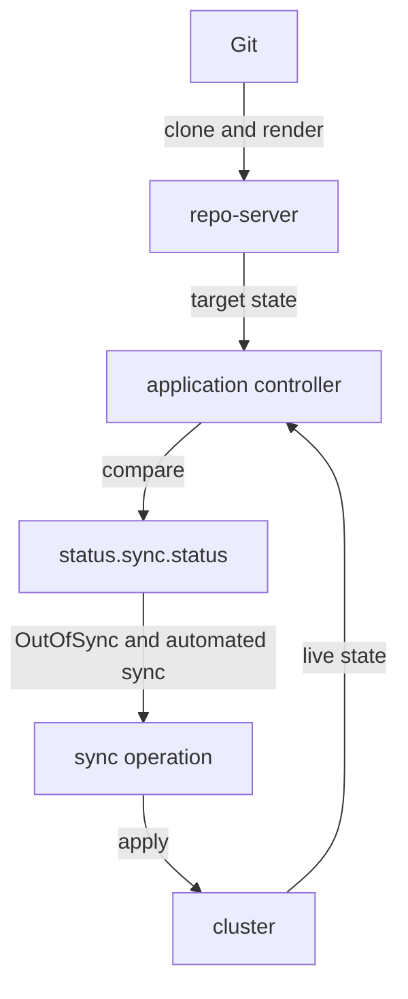

# Refresh, Comparison And Drift

Argo CD keeps two pictures of every Application. One picture is the target state, which is the set of manifests that Git describes. The other picture is the live state, which is what the cluster holds right now. The sync status of the Application is the answer to one question: do these two pictures match? This part explains how Argo CD builds both pictures, when it compares them, and which component does each step. You need this to understand why an Application can show `OutOfSync` without anyone having started a sync.

## Which component does what

Three components of Argo CD take part. The repository server (`argocd-repo-server`) clones the Git repository and renders the manifests for the path and revision of the Application. The rendered manifests are the target state. The application controller (`argocd-application-controller`) watches the objects in the cluster to know the live state, and it compares live state with target state. The Argo CD API server and the `argocd` command line client only show the result or ask the controller to act.

The result of the comparison is stored in the Application itself, in the field `status.sync.status`. The value is `Synced` when the two states match and `OutOfSync` when they differ. The field `status.sync.revision` holds the commit that the target state came from. The field `status.health.status` is a separate answer about whether the resources work, for example `Healthy`, `Progressing` or `Degraded`.

## Refresh compares, sync changes

A refresh is the operation that gets the latest target state and compares it with the live state. It updates the fields of `status`, and nothing else. It never applies a manifest to the cluster. A sync is the operation that applies the target state to the cluster so that the live state moves toward it.

This difference decides how you read an `OutOfSync` status. `OutOfSync` is the result of a refresh. It says that a difference exists. It does not say that Argo CD tried to remove the difference, and without automated sync nothing removes it until someone starts a sync.



The diagram shows that the comparison feeds only the status. A sync operation starts only when someone asks for it or when the automated sync policy asks for it.

## When Argo CD compares

The application controller does not compare only when you ask. It has four triggers.

- A timer. Every Application is refreshed again after the reconciliation timeout, which is 120 seconds by default plus a random jitter of up to 60 seconds. The setting is `timeout.reconciliation` in the ConfigMap `argocd-cm`. On this timer the repository server checks whether the branch has a new commit.
- A change event. The controller watches the managed objects in the cluster. When one changes, the controller compares that Application again without waiting for the timer. This is how a hand edit shows up within seconds.
- A webhook. A Git provider can call the Argo CD API when someone pushes a commit. The call refreshes the matching Applications at once, so Argo CD does not wait for the timer to find the new commit.
- A manual request. A person can ask for a refresh with the annotation `argocd.argoproj.io/refresh` on the Application, with the flag `--refresh` of `argocd app get`, or with the refresh button of the web interface.

A normal refresh reuses what the repository server has cached for the commit it already knows. A hard refresh also throws away the cached manifests for that Application and renders them again. Use a hard refresh when you suspect that a cached render is stale, for example after you change a Helm chart dependency without a new commit. The annotation value `normal` asks for a normal refresh and the value `hard` asks for a hard refresh. The controller removes the annotation when the refresh is done.

## Two kinds of difference

A difference between the two states has one of two origins. The origin decides what the right reaction is.

A source-driven difference starts in Git. Someone merges a commit that changes a manifest, the target state changes, and the live state is now behind. The Application becomes `OutOfSync` after the next refresh, and a sync is the correct fix because the cluster must catch up with Git.

Live drift starts in the cluster. Someone runs `kubectl scale` or `kubectl edit` on a managed object. The target state did not change, and the live state moved away from it. Argo CD calls this drift. Automated sync without self-heal does not react to drift, because the documentation states that changes in the live cluster do not trigger an automated sync by default. With `selfHeal: true` the controller starts a sync, after a short delay of 5 seconds by default, and the sync puts the live state back to the target state.

A fresh commit and a hand edit can both give `OutOfSync`, so look at `status.sync.revision` and the history before you decide. If the revision is the one you expected, the difference lives in the cluster.

## What counts as a difference

Argo CD does not compare every byte of a live object. A live object holds many fields that the cluster fills in, such as `status`, `metadata.uid`, the resource version and defaulted values. Argo CD compares the fields that the manifest declares, after it normalises the live object, so these cluster-written fields do not make an Application `OutOfSync`. A field that only exists in the live object and has no counterpart in Git is not drift either.

This rule has a practical effect. If someone adds an extra annotation to a Deployment by hand, the Application stays `Synced`, because Git does not declare that annotation. If someone changes `spec.replicas`, which Git does declare, the Application becomes `OutOfSync`.

## Try it: read a refresh in the playground

Connect to the playground and set the namespace for the `argocd` client in core mode, which talks to the Kubernetes API directly and needs no login:

<!-- astrona:playground:renew -->

```sh
export KUBECONFIG="$(astrona kubeconfig ats-061-playground-050-01)"
kubectl config current-context
kubectl config set-context --current --namespace=argocd
```

Save this Application as `application-observer.yaml`. It has no sync policy, so it never syncs by itself:

```yaml
apiVersion: argoproj.io/v1alpha1
kind: Application
metadata:
  name: observer
  namespace: argocd
spec:
  project: default
  source:
    repoURL: http://git-source.argocd.svc:8080/repo.git
    targetRevision: main
    path: plain
  destination:
    server: https://kubernetes.default.svc
    namespace: starfleet
```

Apply it and read the first result:

```sh
kubectl apply -f application-observer.yaml
kubectl -n argocd get application observer -o jsonpath='{.status.sync.status}{" "}{.status.sync.revision}{"\n"}'
```

The status is `OutOfSync`, because the Deployment `git-probe` does not exist yet, and the revision is the commit of `main`. The refresh found the difference and changed nothing in the cluster. Run `kubectl -n starfleet get deployment git-probe` and see that the Deployment is not there. Start the sync, scale the Deployment by hand, and read the status again:

```sh
argocd app sync observer --core
kubectl -n starfleet scale deployment git-probe --replicas=3
argocd app get observer --refresh --core
```

After the sync the status is `Synced`. After the scale and the refresh the status is `OutOfSync`, and the output lists the Deployment `git-probe` as the resource that differs. This is live drift. Nothing repairs it, because the Application has no automated sync. Remove the Application and the objects it created with `kubectl -n argocd delete application observer` and `kubectl -n starfleet delete deployment,service git-probe`. The Application has no finalizer, so the first command alone leaves the Deployment and the Service in the cluster.

## What the part showed

Argo CD builds the target state from Git in the repository server and the live state from the cluster in the application controller, and it compares them on a timer, on change events, on webhooks and on request. A refresh only updates the status. A sync changes the cluster. A difference that starts in Git calls for a sync, and a difference that starts in the cluster is drift that only self-heal repairs by itself. The part did not cover differences that are expected, such as a field that another controller sets on purpose.

## Common pitfalls

> [!WARNING]
> Do not read `OutOfSync` as a failed sync. It is the result of a comparison, and no sync ran. Also, a refresh does not fix drift: if the status stays `OutOfSync` after a refresh, the refresh worked and a sync is still needed.
