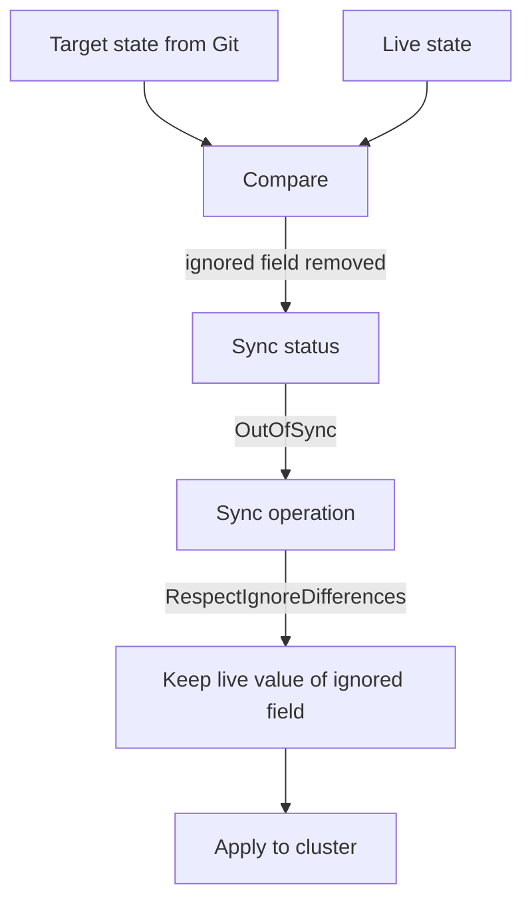

# Ignore Differences And Controller-Owned Fields

Git is not always the only writer of a live object. A HorizontalPodAutoscaler changes the replica count of a Deployment while the load changes. An admission webhook injects a sidecar container into a pod template. A certificate controller writes a CA bundle into a webhook configuration. In each case a controller changes a field that Git also declares, and the Application shows `OutOfSync` all the time. This part explains how to tell Argo CD which fields to leave out of the comparison, how to keep a sync from overwriting them, and how to keep the exception small.

## Why a field needs an exception

A HorizontalPodAutoscaler (HPA) is a Kubernetes controller that sets `spec.replicas` of a Deployment from a measured load. Suppose the manifest in Git says `replicas: 2` and the HPA has scaled the Deployment to 5. The target state says 2 and the live state says 5. Argo CD reports `OutOfSync`. With self-heal on, it also scales the Deployment back to 2, and the HPA scales it up again. The two controllers overwrite each other without end.

The cause is that two writers own one field. The fix is to decide that the controller owns the field and to tell Argo CD to stop treating it as part of the desired state. Removing `replicas` from the manifest is the other fix, and it is the better one when you can do it, because then Git does not declare a value that nobody enforces. The exception is for the cases where the field must stay in the manifest, for example because a Helm chart always writes it.

## The ignoreDifferences block

The Application field `spec.ignoreDifferences` is a list. Each entry selects objects and names the fields to leave out of the comparison:

```yaml
spec:
  ignoreDifferences:
  - group: apps
    kind: Deployment
    name: git-probe
    namespace: starfleet
    jsonPointers:
    - /spec/replicas
```

The `group` is the Kubernetes API group without the version. A Deployment belongs to the group `apps`, and an object of the core group, such as a Service, has an empty group. The `kind` is the object kind. The fields `name` and `namespace` are optional and narrow the entry to one object. Without them the entry applies to every object of that group and kind in the Application.

Three ways to name the fields exist.

- `jsonPointers` is a list of JSON pointers, which are paths such as `/spec/replicas`. A slash inside a key is written as `~1`, so the annotation `lab.example.io/review` is `/metadata/annotations/lab.example.io~1review`.
- `jqPathExpressions` is a list of jq path expressions. Use it when the field sits inside a list and you must pick the list item by content, for example an injected container selected by its name.
- `managedFieldsManagers` is a list of field manager names. Argo CD then ignores every field that one of these managers owns in `metadata.managedFields` of the live object. Use it when a controller writes many fields and you want one rule instead of many pointers.

An exception can also live in the `argocd-cm` ConfigMap. The key `resource.customizations.ignoreDifferences.apps_Deployment` applies to every Application in the installation, and the key `resource.customizations.ignoreDifferences.all` applies to every kind. A rule there is invisible to the owner of an Application, so keep system-wide rules for fields that no one should ever enforce.

## A comparison rule is not a sync rule

By default `ignoreDifferences` affects only the comparison. It decides whether the Application is `Synced` or `OutOfSync`. When a sync runs for another reason, Argo CD still applies the complete target state, so the ignored field in Git overwrites the live value. For the Deployment above, a sync that fixes a changed image would also set `replicas` back to 2, and the HPA would have to scale again.

The sync option `RespectIgnoreDifferences=true` changes this. Argo CD calculates the desired state, takes the ignored fields from the live object and patches them into the desired state before it applies it. The sync then leaves the ignored fields as the controller set them. The option sits in the sync policy:

```yaml
spec:
  syncPolicy:
    syncOptions:
    - RespectIgnoreDifferences=true
```

One limit matters. The option works only when the object already exists in the cluster. During the first sync no live object exists, so Argo CD applies the desired state as it is, and the ignored field gets the value from Git. The controller or the person then changes it, and later syncs respect the live value.



The diagram shows two places where the rule acts. The first is the comparison, which always uses the rule. The second is the sync, which uses the rule only when the sync option is on.

## Keep the exception narrow

An ignore rule removes a field from view, so every field it covers is a field where Argo CD will not report a wrong value. A rule for `/spec/replicas` on one Deployment is small. A rule with `kind: '*'` and the pointer `/spec` hides every change to every object, including a changed image, a new command or a privileged security context. Argo CD would show `Synced` while the cluster runs something else.

Use these habits to keep a rule safe. Name the kind, and add the object name when only one object needs the exception. Name the narrowest pointer that covers the field. Prefer `managedFieldsManagers` for a controller that really owns a field set. Write a comment next to the rule that names the controller that owns the field.

Also check that the owning controller really exists. A rule for `/spec/replicas` with no HPA behind it only means that nobody enforces the replica count at all. A hand edit then stays, and the Application is still `Synced`.

## Try it: see the effect of the rule

Connect to the playground and set the namespace for the `argocd` client:

<!-- astrona:playground:renew -->

```sh
export KUBECONFIG="$(astrona kubeconfig ats-061-playground-050-01)"
kubectl config current-context
kubectl config set-context --current --namespace=argocd
```

Save this Application as `application-ignore.yaml`. It has automated sync with self-heal, and a rule that ignores the replica count:

```yaml
apiVersion: argoproj.io/v1alpha1
kind: Application
metadata:
  name: ignore-demo
  namespace: argocd
spec:
  project: default
  source:
    repoURL: http://git-source.argocd.svc:8080/repo.git
    targetRevision: main
    path: plain
  destination:
    server: https://kubernetes.default.svc
    namespace: starfleet
  syncPolicy:
    automated:
      prune: true
      selfHeal: true
    syncOptions:
    - CreateNamespace=true
  ignoreDifferences:
  - group: apps
    kind: Deployment
    jsonPointers:
    - /spec/replicas
```

Apply it, wait for the Deployment and scale it by hand:

```sh
kubectl apply -f application-ignore.yaml
kubectl -n argocd wait --for=jsonpath='{.status.health.status}'=Healthy application/ignore-demo --timeout=240s
kubectl -n starfleet scale deployment git-probe --replicas=4
```

Wait about 30 seconds and read the Application and the replica count:

```sh
kubectl -n argocd get application ignore-demo -o jsonpath='{.status.sync.status}{"\n"}'
kubectl -n starfleet get deployment git-probe -o jsonpath='{.spec.replicas}{"\n"}'
```

The status is `Synced` and the count is still 4. Self-heal did not run, because the comparison does not see a difference. Remove the Application and its objects when you are done. The Application has no finalizer, so the first command leaves the Deployment and the Service in place and the second command removes them:

```sh
kubectl -n argocd delete application ignore-demo
kubectl -n starfleet delete deployment,service git-probe
```

## What the part showed

Two controllers that write one field overwrite each other unless one of them leaves it alone. The `ignoreDifferences` block removes fields from the comparison, by JSON pointer, by jq path expression or by field manager. The sync option `RespectIgnoreDifferences=true` makes the sync keep the live value of those fields as well. A narrow rule documents who owns a field, and a wide rule hides real changes. The part did not cover how an Application can create other Applications, which adds another owner of the same objects.

## Common pitfalls

> [!WARNING]
> The ignore rule alone does not stop a sync from overwriting the field. Add `RespectIgnoreDifferences=true`, and remember that it has no effect on the first sync of an object. Also, never use `kind: '*'` with a pointer like `/spec` to quiet one noisy field. That rule hides image, command and security changes too.
