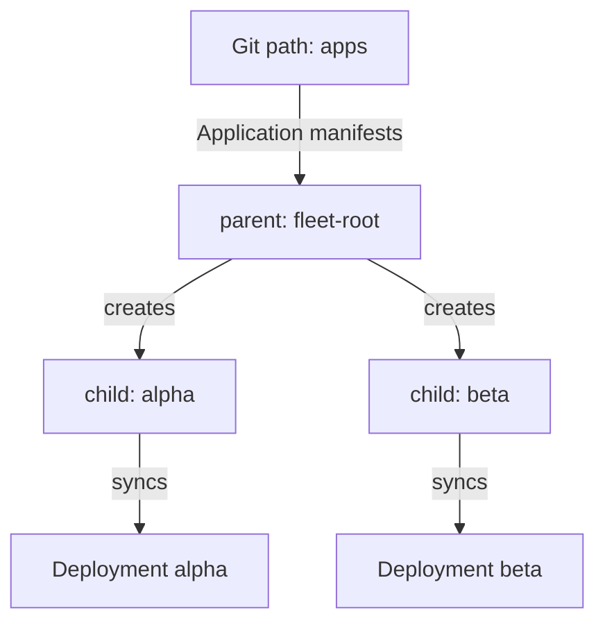

# Bootstrap With An App Of Apps

An Application is a Kubernetes object, so something has to create it. For one Application a person can run `kubectl apply`. For thirty Applications on ten clusters the same task needs a list, an order and a way to repair it when someone deletes one. The app-of-apps pattern moves that list into Git and lets Argo CD apply it. This part explains how the pattern works, which component does each step and what the parent Application owns.

## The parent and the children

A child Application is an ordinary Application. It points at a Git path with workload manifests and deploys them to a destination. A parent Application is also an ordinary Application. The only difference is its content: the Git path of the parent holds manifests of kind `Application`. When the parent syncs, Argo CD applies those manifests, and the cluster then holds one Application object for each file.

The application controller does the rest. It sees each new Application object and reconciles it like any other. A child with automated sync then compares its own path and syncs its own workloads. The parent never touches the workloads. It manages only the child Application objects.



The diagram shows two layers. The parent owns the two child Application objects, and each child owns its own Deployment.

## The parent manifest

The parent is a normal Application. Two fields need care. The path points to the directory that holds the child manifests. The destination namespace is `argocd`, because Application objects must live in the namespace where Argo CD is installed. A child Application in another namespace is not reconciled, unless the installation allows Applications in other namespaces.

```yaml
apiVersion: argoproj.io/v1alpha1
kind: Application
metadata:
  name: fleet-root
  namespace: argocd
spec:
  project: default
  source:
    repoURL: http://git-source.argocd.svc:8080/repo.git
    targetRevision: main
    path: apps
  destination:
    server: https://kubernetes.default.svc
    namespace: argocd
  syncPolicy:
    automated:
      prune: true
      selfHeal: true
```

Each child manifest is an Application with `metadata.namespace: argocd`. Its `spec.source` names the repository, revision and path of the workload and its `spec.destination` names the cluster and namespace. A directory source loads the YAML files of the path as they are. It does not search subdirectories unless the source sets `directory.recurse`.

## Who owns which object

Argo CD marks every object that it creates with a tracking annotation, `argocd.argoproj.io/tracking-id`, whose value starts with the name of the owning Application. A child Application created by `fleet-root` carries the value `fleet-root:argoproj.io/Application:argocd/alpha`. The Deployment that the child `alpha` creates carries a value that starts with `alpha:`. This is how Argo CD knows which Application a resource belongs to, and it is the first thing to read when two Applications seem to fight over one object.

Because the parent owns the child Application objects, it also compares them. Suppose someone edits the live child `alpha` and sets another revision. The target state of the parent still holds the original manifest, so the parent becomes `OutOfSync`. With self-heal on, the parent applies its manifest again and the edit disappears. The same happens when someone deletes a child: the parent sees a missing object and creates it again.

## Pruning and deletion

Automated sync with `prune: true` on the parent removes a child Application when its manifest leaves Git. What happens to the workloads of that child depends on a finalizer. A finalizer is a name in `metadata.finalizers` that tells Kubernetes to wait for a controller before it removes the object.

If the child has the finalizer `resources-finalizer.argocd.argoproj.io`, the application controller first deletes the resources that the child manages and then lets the child go. This is a cascading delete. Without the finalizer, only the Application object is removed and the Deployment and the Service stay in the cluster. They are orphaned: no Application owns them any more. The Argo CD documentation recommends the finalizer on children when the parent should clean up everything it created. Leave it off when the workloads must survive the removal of their Application.

The same rule applies to the parent. Deleting a parent that has the finalizer deletes its resources, which are the child Application objects, and each child with the finalizer deletes its workloads in turn.

## Order and health

The parent sync applies all child manifests together by default. To start children in an order, add the annotation `argocd.argoproj.io/sync-wave` to the child manifests. The parent then applies the lowest wave first and waits for those Applications to be healthy before it applies the next wave. Argo CD derives the health of an Application object from the health of its resources, so a wave finishes when the children of that wave are healthy.

This also means that the health of the parent reflects the children. The parent shows `Progressing` while a child still rolls out, and `Degraded` when a child is degraded.

## A note on trust

An author of a parent manifest can create Applications in any project, including projects with wide permissions. Only trusted people should have write access to the Git path of a parent, and the parent itself should live in a project that restricts the allowed repositories and destinations. The pattern is a tool for the people who run the cluster, not for every team.

## Try it: create the parent

Connect to the playground and select the namespace `argocd`:

<!-- astrona:playground:renew -->

```sh
export KUBECONFIG="$(astrona kubeconfig ats-061-playground-050-02)"
kubectl config current-context
kubectl config set-context --current --namespace=argocd
```

Save the parent manifest from above as `application-fleet-root.yaml`, apply it and wait until the parent is healthy:

```sh
kubectl apply -f application-fleet-root.yaml
kubectl -n argocd wait --for=jsonpath='{.status.health.status}'=Healthy application/fleet-root --timeout=240s
kubectl -n argocd get applications
```

The last command lists three Applications: `fleet-root`, `alpha` and `beta`. Read the owner of a child and the Deployment it created:

```sh
kubectl -n argocd get application alpha -o jsonpath='{.metadata.annotations.argocd\.argoproj\.io/tracking-id}{"\n"}'
kubectl -n starfleet get deployment alpha -o jsonpath='{.metadata.annotations.argocd\.argoproj\.io/tracking-id}{"\n"}'
```

The first value names `fleet-root` as the owner of the child, and the second value names `alpha` as the owner of the Deployment.

## What the part showed

The app-of-apps pattern uses one Application whose path holds Application manifests. The parent owns the child Application objects and compares and repairs them. Each child owns its own workloads. A finalizer decides whether removing a child also removes the workloads. The part did not cover what happens when a child is edited, deleted or broken while the parent runs.

## Common pitfalls

> [!WARNING]
> Make sure every child Application object ends up in the namespace `argocd`: set `metadata.namespace: argocd` in each child manifest and use `argocd` as the destination namespace of the parent. A child object in another namespace is never reconciled. Also, do not expect a prune of a child to remove its workloads unless the child has the finalizer.
