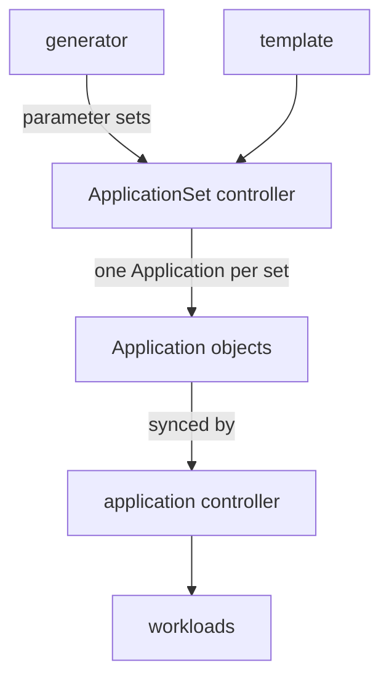

# ApplicationSet Generators And Templates

Suppose a team runs the same service in three environments. The three Application manifests differ in only a few values: the name, the namespace and the replica count. Copying the file and editing it works until the team has forty services and a fourth environment. An ApplicationSet replaces the copies with one template. This part explains the pieces of an ApplicationSet, how the controller turns parameters into Applications and how this differs from the app-of-apps pattern.

## The ApplicationSet object and its controller

An ApplicationSet is a Kubernetes object of the kind `ApplicationSet` in the group `argoproj.io`. A separate component of the Argo CD installation, the ApplicationSet controller (`argocd-applicationset-controller`), watches these objects. The application controller does not read them. For each ApplicationSet the ApplicationSet controller creates, updates and deletes Application objects. The application controller then reconciles those Applications like any other Application.

An ApplicationSet has two main parts. The `generators` list produces parameter sets, which are lists of key and value pairs. The `template` describes an Application with placeholders. The controller renders the template once for every parameter set, and each rendered template becomes one Application.



The diagram shows that the ApplicationSet controller stops at the Application objects. The workloads belong to the application controller.

## Generators

A generator answers the question: what Applications should exist? Four generator types are common.

- The list generator holds a fixed list of elements in the ApplicationSet itself. Each element is one parameter set.
- The cluster generator creates one parameter set for each cluster that Argo CD knows.
- The Git generator reads a Git repository. In directory mode it creates one parameter set for each directory that matches a path pattern. In files mode it reads each file that matches a pattern, for example `envs/*/config.json`, and turns the content of the file into parameters.
- The matrix generator combines the parameter sets of two other generators, for example every environment on every cluster.

For the files mode, the fields of a JSON file become parameters. A file with `"environment": "dev"` gives the parameter `environment`. Nested fields are joined with a dot, and the generator adds the parameters `path.path`, `path.basename` and `path.filename` that describe where the file was found. The controller reads Git again about every three minutes by default, and a webhook can shorten the delay.

## The template

The template has the same shape as an Application, with `metadata` and `spec`, and it can use the parameters. The setting `goTemplate: true` selects Go template syntax, in which a parameter is written as `{{ .environment }}`. With `goTemplateOptions: ["missingkey=error"]` the controller fails with an error when the template names a parameter that the generator did not produce, instead of writing an empty value.

The name of each generated Application must be different, so the `metadata.name` of the template must contain a parameter. Two parameter sets that give the same name collide, and one of them cannot be created.

Here is an ApplicationSet with a list generator. It creates one Application for each element, and each one deploys the workload path that the element names:

```yaml
apiVersion: argoproj.io/v1alpha1
kind: ApplicationSet
metadata:
  name: crew-set
  namespace: argocd
spec:
  goTemplate: true
  goTemplateOptions: ["missingkey=error"]
  generators:
  - list:
      elements:
      - service: alpha
      - service: gamma
  template:
    metadata:
      name: '{{ .service }}-set'
    spec:
      project: default
      source:
        repoURL: http://git-source.argocd.svc:8080/repo.git
        targetRevision: main
        path: 'workloads/{{ .service }}'
      destination:
        server: https://kubernetes.default.svc
        namespace: starfleet
      syncPolicy:
        automated:
          prune: true
          selfHeal: true
```

The controller renders this template twice and creates the Applications `alpha-set` and `gamma-set`.

## Who owns a generated Application

The ApplicationSet controller sets an owner reference on every Application it creates. An owner reference is a field in `metadata.ownerReferences` that names the owning object, here the ApplicationSet. The controller keeps the spec of each generated Application equal to the rendered template. If someone edits a generated Application, the controller patches it back. If someone deletes it, the controller creates it again at its next reconciliation. If a parameter set disappears, for example because the file left Git, the controller deletes the Application.

The ApplicationSet has a policy that limits this. The default policy `sync` allows create, update and delete. The policies `create-only`, `create-update` and `create-delete` remove some of these powers. The controller setting that applies it is a flag of the controller, and a per-ApplicationSet override works only when that override is enabled. When an ApplicationSet is deleted, Kubernetes deletes the owned Applications. The documentation states that, unless `preserveResourcesOnDeletion: true` is set in the `syncPolicy` of the ApplicationSet, the workloads of the deleted Applications are removed as well.

## ApplicationSet compared with app-of-apps

Both patterns create Applications from Git, but they differ in what Git holds and who owns the result.

With app-of-apps, Git holds one full manifest for each child. A person writes each manifest, and the parent is an ordinary Application that syncs the files. The ownership is recorded in the tracking annotation, and the application controller repairs the children. With an ApplicationSet, Git or the ApplicationSet holds only the inputs, which are a list or small data files. The template creates the manifests. The ownership is recorded in an owner reference, and the ApplicationSet controller repairs the children.

Choose app-of-apps when the children differ a lot, when each child needs its own settings or sync waves and when the list is short. Choose an ApplicationSet when the children are variations of one pattern, when the inputs change often or when one Git file should be enough to add an environment. A cluster can use both at once: a parent Application can sync ApplicationSet manifests.

## Try it: generate two Applications

Connect to the playground and select the namespace `argocd`:

<!-- astrona:playground:renew -->

```sh
export KUBECONFIG="$(astrona kubeconfig ats-061-playground-050-03)"
kubectl config current-context
kubectl config set-context --current --namespace=argocd
```

Save the ApplicationSet above as `applicationset-crew-set.yaml`, apply it and list the Applications:

```sh
kubectl apply -f applicationset-crew-set.yaml
kubectl -n argocd get applications
kubectl -n argocd get application alpha-set -o jsonpath='{.metadata.ownerReferences[0].kind}{" "}{.metadata.ownerReferences[0].name}{"\n"}'
```

The list shows `alpha-set` and `gamma-set`, and the owner is the `ApplicationSet` named `crew-set`. Wait until both are `Synced` and `Healthy`, and delete the ApplicationSet again so the next exercise starts clean:

```sh
kubectl -n argocd delete applicationset crew-set
kubectl -n argocd get applications
```

The owned Applications disappear. By default their workloads are removed together with them.

## What the part showed

An ApplicationSet turns parameter sets into Applications with a template, and the ApplicationSet controller owns, repairs and deletes them through owner references. App-of-apps and ApplicationSet differ in what Git holds and in which component owns the children. The part did not cover the Git files generator in detail or the failure cases of a generated Application.

## Common pitfalls

> [!WARNING]
> Make the generated name unique, or two parameter sets collide on one Application. Also, deleting an ApplicationSet deletes its Applications, and without `preserveResourcesOnDeletion: true` it removes their workloads too.
